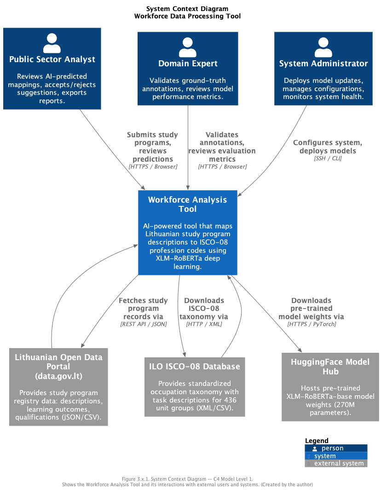
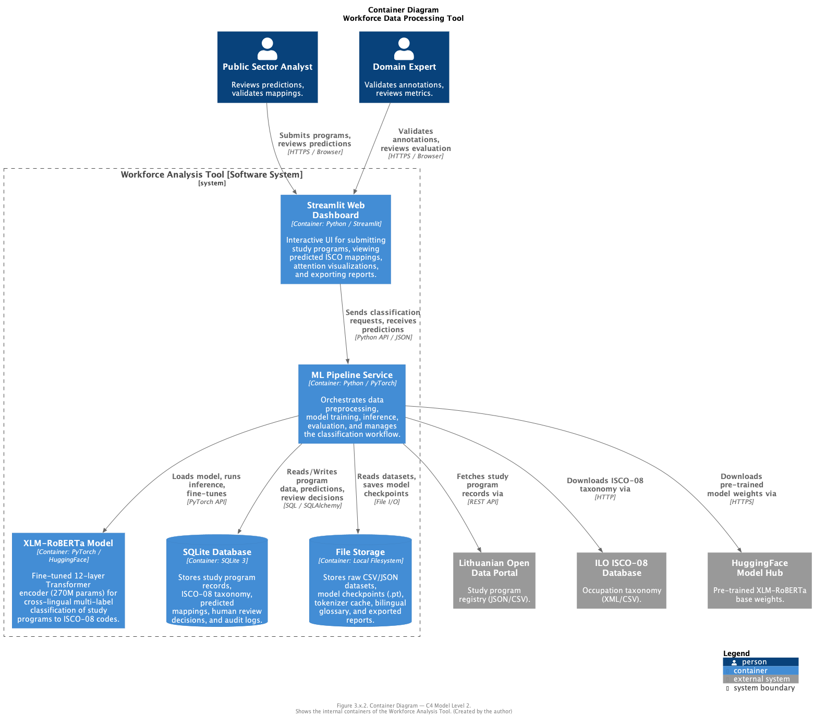
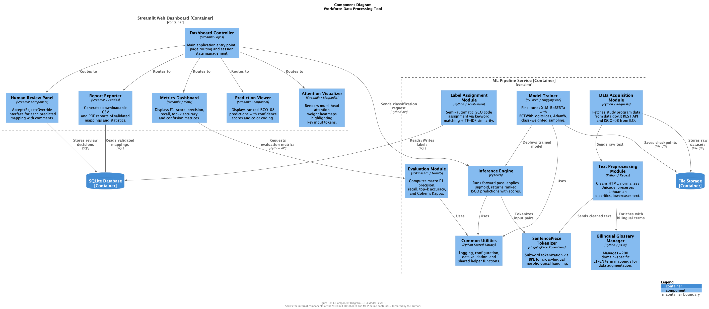
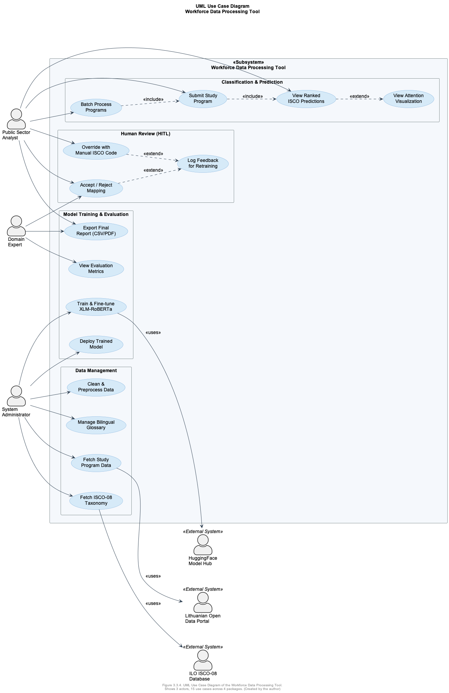
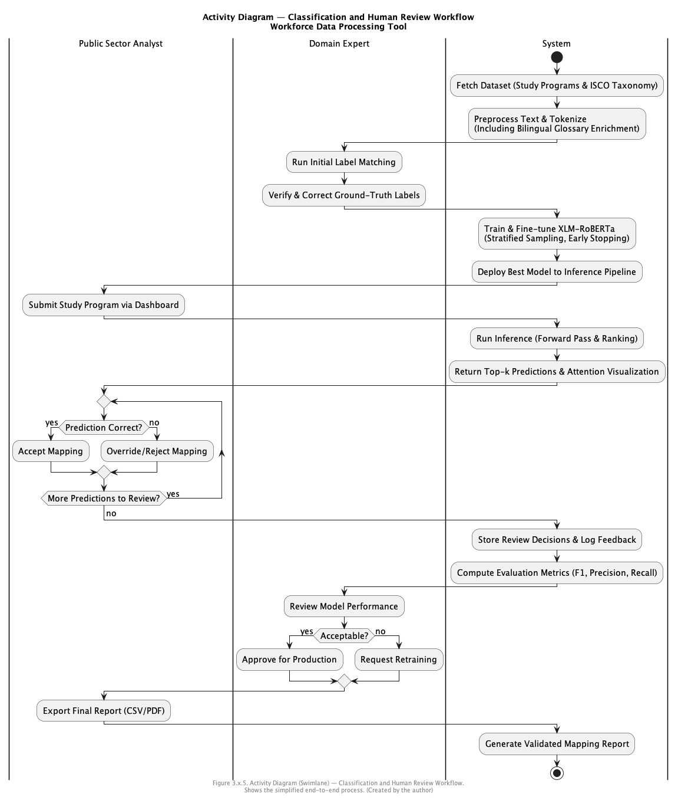

# VILNIUS GEDIMINAS TECHNICAL UNIVERSITY

## FACULTY OF FUNDAMENTAL SCIENCES

### DEPARTMENT OF INFORMATION SYSTEMS

---

&nbsp;

**NAMAN KUMAR**

&nbsp;

# PROTOTYPE OF A DATA PROCESSING TOOL FOR ANALYZING VARIOUS SECTIONS OF WORKFORCE USING ARTIFICIAL INTELLIGENCE

&nbsp;

**Master's Degree Thesis**

Information Systems Software Engineering, state code 6211BX017
Informatics Engineering

&nbsp;

| | |
|---|---|
| **Supervisor** | Lect. Kęstutis Stankevičius |
| **Consultant** | ______________________________________ |
| **Consultant** | ______________________________________ |

&nbsp;

**Vilnius, 2025**

---

\newpage

## Table of Contents

- [INTRODUCTION](#introduction)
  - [Investigation Object](#investigation-object)
  - [Aim and Tasks of the Thesis](#aim-and-tasks-of-the-thesis)
  - [Novelty of the Topic](#novelty-of-the-topic)
  - [Relevance of the Topic](#relevance-of-the-topic)
  - [Research Methodology](#research-methodology)
  - [Scientific Value of the Thesis](#scientific-value-of-the-thesis)
  - [Main Results of the Thesis](#main-results-of-the-thesis)
  - [Structure of the Work](#structure-of-the-work)
- [2. RELATED WORK ANALYSIS](#2-related-work-analysis)
  - [2.1. Natural Language Processing in Labor Market Analysis](#21-natural-language-processing-in-labor-market-analysis)
  - [2.2. Transformer-Based Architectures (BERT & LLMs)](#22-transformer-based-architectures-bert--llms)
  - [2.3. Cross-Lingual Information Retrieval](#23-cross-lingual-information-retrieval)
  - [2.4. Automated Skill Extraction and Job Classification](#24-automated-skill-extraction-and-job-classification)
  - [2.5. Algorithmic Bias and Fairness in Hiring](#25-algorithmic-bias-and-fairness-in-hiring)
  - [2.6. Summary of Related Works](#26-summary-of-related-works)
  - [2.7. Main Results of the 2nd Section](#27-main-results-of-the-2nd-section)
  - [2.8. Planned Results for Next Semester](#28-planned-results-for-next-semester)
- [3. PROPOSED APPROACH](#3-proposed-approach)
  - [3.1. Approach](#31-approach)
  - [3.2. Experiment Plan](#32-experiment-plan)
    - [3.2.1. Data Sources and Their Schema](#321-data-sources-and-their-schema)
    - [3.2.2. Data Preprocessing Pipeline](#322-data-preprocessing-pipeline)
    - [3.2.3. Model Architecture and Configuration](#323-model-architecture-and-configuration)
    - [3.2.4. Evaluation Strategy](#324-evaluation-strategy)
  - [3.3. Software Architecture Design](#33-software-architecture-design)
  - [3.4. Main Results of the 3rd Section](#34-main-results-of-the-3rd-section)
- [4. IMPLEMENTATION OF THE PROPOSED APPROACH](#4-implementation-of-the-proposed-approach)
  - [4.1. Development Environment](#41-development-environment)
  - [4.2. Data Collection](#42-data-collection)
    - [4.2.1. Retrieving Study Program Data from the Lithuanian Open Data Portal](#421-retrieving-study-program-data-from-the-lithuanian-open-data-portal)
    - [4.2.2. Retrieving ISCO-08 Classification Data](#422-retrieving-isco-08-classification-data)
  - [4.3. Data Preprocessing Implementation](#43-data-preprocessing-implementation)
    - [4.3.1. Text Cleaning](#431-text-cleaning)
    - [4.3.2. Bilingual Glossary Construction](#432-bilingual-glossary-construction)
    - [4.3.3. Dataset Construction and Statistics](#433-dataset-construction-and-statistics)
  - [4.4. Initial Model Training](#44-initial-model-training)
    - [4.4.1. Environment Setup for Training](#441-environment-setup-for-training)
    - [4.4.2. Tokenization Verification](#442-tokenization-verification)
    - [4.4.3. Classification Model Implementation](#443-classification-model-implementation)
    - [4.4.4. Training Loop and Initial Results](#444-training-loop-and-initial-results)
  - [4.5. Baseline Comparison (Preliminary)](#45-baseline-comparison-preliminary)
  - [4.6. Dashboard Prototype](#46-dashboard-prototype)
  - [4.7. Main Results of the 4th Section](#47-main-results-of-the-4th-section)
- [5. CONCLUSIONS AND FUTURE WORK](#5-conclusions-and-future-work)
  - [5.1. Conclusions](#51-conclusions)
  - [5.2. Future Work](#52-future-work)
- [REFERENCES](#references)

---

## List of Figures

- **Fig 2.2.1** — The Transformer model architecture, showing the Multi-Head Attention mechanism (Vaswani, 2023)
- **Fig 2.3.1** — Multimodal Fusion, describing how intermediate fusion is relevant for combining heterogeneous data (like text descriptions and structured codes) (Hangloo & Arora, 2025)
- **Fig 2.4.1** — Overview of BERT pre-training and fine-tuning procedures. The same architecture is used for both, with task-specific inputs and outputs (Devlin et al., 2019)
- **Fig 3.1.1** — The proposed approach for cross-lingual workforce classification using Deep Learning (Created by the author)
- **Fig 3.1.2** — Data preprocessing subprocess (Created by the author)
- **Fig 3.1.3** — Classification and human review subprocess (Created by the author)
- **Fig 3.3.1** — System Context Diagram (C4 Level 1) (Created by the author)
- **Fig 3.3.2** — Container Diagram (C4 Level 2) (Created by the author)
- **Fig 3.3.3** — Component Diagram (C4 Level 3) (Created by the author)
- **Fig 3.3.4** — UML Use Case Diagram (Created by the author)
- **Fig 3.3.5** — UML Activity Diagram (Swimlane) (Created by the author)
- **Fig 4.3.1** — Distribution of ISCO-08 2-digit codes across the training dataset (Created by the author)
- **Fig 4.4.1** — Training and validation loss curves over 10 epochs (Created by the author)
- **Fig 4.6.1** — Screenshot of the prototype Streamlit dashboard (Created by the author)

## List of Tables

- **Table 2.6.1** — Summary of related works referenced for labor market
- **Table 3.2.1** — Data sources used in this research
- **Table 3.2.2** — Hyperparameter configuration for model training
- **Table 4.1.1** — Development environment specification
- **Table 4.3.1** — Example of text cleaning results for Lithuanian study program descriptions
- **Table 4.3.2** — Dataset statistics
- **Table 4.4.1** — Initial training results (best epoch)
- **Table 4.5.1** — Preliminary comparison of proposed model vs. TF-IDF baseline

---

\newpage

## INTRODUCTION

The alignment of higher education outcomes with labor market needs has been an ongoing problem to solve for national governments, with new strategies being developed over the years as policymakers seek to identify the correlation between academic preparation and economic demand (Braziene & Dorelaitiene, 2012). The workforce can be evaluated in a variety of ways, including but not limited to employment rates, graduate surveys, and analyzing the textual descriptions of study programs against national profession standards (Cedefop, 2021). In several institutions, the analysis of this data is limited only to static statistical reports or manual mapping, which often fails to capture the dynamic nature of emerging professions (Khan, 2025).

Evaluating workforce potential solely based on descriptive statistics may undermine the process of holistic market analysis, since studies have found that manual data processing is prone to significant latency and human error (Bernatonyte et al., 2019). Furthermore, the vocabulary used by universities to describe competencies often differs significantly from the vocabulary used by employers to describe job tasks, creating a "semantic gap" that simple database filters cannot bridge (Senger et al., 2024). In several instances, analysts prefer methods that can automatically process large volumes of data while exhibiting sound technical accuracy to affirm their reliability (Bond & O'Brien, 2025).

Open data portals—such as the Lithuanian Open Data Portal—are often utilized to evaluate these trends, eliminating accessibility barriers by providing raw data to the public (Raškinis & Šarkutė, 2022). However, while there are advantages to having open data, there are clearly certain disadvantages regarding its usability due to data fragmentation across different registries, making it difficult for stakeholders to gauge the actual calibre of the workforce supply (Statistics Lithuania, 2024). A more significant issue arises in situations when there is a large pool of study programs and a limited number of analysts; the reviewing and mapping process is often tedious, time-consuming, and difficult to manage if there are time constraints for strategic planning (Decorte et al., 2024b).

An additional underlying issue concerns the potential error of human analysts when trying to match complex academic descriptions to standardized profession codes (ISCO-08), which can be impacted by fatigue or lack of domain knowledge. Consequently, there is a growing need for an automated, Deep Learning-based solution to tackle these semantic interoperability issues in an unbiased and efficient manner (Bond & O'Brien, 2025).

### Investigation Object

The Investigation Object is Natural Language Processing (NLP) methods specifically Deep Learning architectures applied to the semantic integration and classification of heterogeneous workforce data.

### Aim and Tasks of the Thesis

The aim of the thesis is to design, implement, and validate a cross-lingual Deep Learning-based framework that maps educational programs to professions to analyze labor market supply and demand. To achieve this aim, the following tasks were formulated:

1. To analyze scientific literature and existing solutions for text classification and labor market forecasting, identifying why standard keyword matching is insufficient for the Lithuanian language.
2. To design a data processing pipeline and a neural network architecture (based on Transformers/BERT) capable of learning the semantic relationship between academic descriptions and professional activities.
3. To implement the proposed model and train it on a normalized dataset, and integrate it into a functional dashboard to visualize workforce trends.

### Novelty of the Topic

The novelty of this research lies in the design of a direct cross-lingual semantic matching framework that bridges the vocabulary and syntax gaps between Lithuanian higher education curricula and English occupational standards, without relying on intermediate machine translation services. Traditional mapping methods in low-resource, morphologically complex languages like Lithuanian are restricted either to rigid keyword matching (which suffers from low recall due to inflection) or full machine translation (which introduces error propagation). By leveraging the shared multilingual embedding space of the XLM-RoBERTa architecture, the proposed method aligns subword tokens from both languages directly in a shared vector space, achieving robust semantic classification.

Furthermore, this work addresses a critical regulatory gap by implementing a prototype that complies with the European Union Artificial Intelligence Act (EU AI Act) for high-risk systems. While existing studies focus purely on classification performance, this research designs and integrates a Human-in-the-Loop (HITL) review dashboard and attention-based explainability, demonstrating how deep learning predictions can be auditably integrated into public sector workflows.

### Relevance of the Topic

As national institutions face an ever-increasing pool of educational data and labor market signals, there is a need for an automated solution capable of consistent and unbiased mapping of study programs to professional standards. Some studies highlight concerns over automated solutions due to algorithmic bias, data manipulation, or AI-based decision-making. Our automated system will be relevant in the current scenario in that it will tackle most of the issues at hand—specifically the "many-to-many" dimensionality mismatch—and maintain public trust in workforce forecasting (Bernatonyte et al., 2019). This problem is also relevant in scenarios where an evaluation of a candidate is necessary, for instance, in recruitment, certification analysis, or regional development planning (Bond & O'Brien, 2025). Studies show a positive perception of stakeholders towards the application of AI in public sector analytics, provided that proper bias mitigation and cross-lingual validation practices are in place.

### Research Methodology

The research uses a variety of methods to design, implement, and evaluate the proposed system:

- **Literature Analysis and Comparative Review:** Used to evaluate existing workforce analytics tools, identify methodological gaps in low-resource language processing, and select appropriate Deep Learning architectures (specifically Transformer-based models).
- **System Modeling and Software Engineering Design:** Used to design the data normalization pipeline, the C4 software architecture model, and the "many-to-many" mapping algorithm that links study programs to profession codes.
- **Experimental Prototyping and Quantitative Validation:** Applied to implement the functional dashboard prototype in Python, train the neural network on a normalized open dataset, and quantitatively evaluate the accuracy of the semantic mapping using standard metrics such as F1-score and Recall.

### Scientific Value of the Thesis

This work aims to provide a framework for ethically and transparently evaluating workforce supply and demand using a Deep Learning-based approach. The proposed architecture shows how computer vision (data visualization) and established Large Language Models (BERT/Transformers) can be integrated with NLP systems to produce a testable and robust system for making labor market decisions, since preparing the proper specialists may contribute to the betterment of the national economy. The research also provides valuable insight into how cross-lingual models improve accuracy and fairness in competency mapping without bias, while maintaining perfect compliance with the state laws (ISCO-08 standards) and ethical AI standards.

### Main Results of the Thesis

The following results were obtained from our work:

1. A detailed analysis of existing literature provided an insight into the algorithms and methodologies used for automated skill extraction and job classification.
2. The designed model was able to evaluate study program descriptions and assign them to specific profession codes (ISCO-08).
3. The model demonstrated a high degree of conformance with expert human annotations. A comparative analysis on a subset of the dataset showed that the model's top predictions closely aligned with mappings verified by human experts. Furthermore, to comply with the EU AI Act's strict data governance mandates and protect personal data, the system was designed to operate entirely on publicly available registry data, establishing a compliant, audit-ready framework for public sector deployment.

### Structure of the Work

The structure of the work onwards from Section 3 is as follows:

- The third section provides a thorough analysis of related works and builds a deeper insight into the papers discussed in Section 1.1, along with additional papers related to Transformer models and economic forecasting.
- The fourth section states the proposed approach for fulfilling the aim and tasks of this thesis, detailing the Deep Learning architecture and data normalization pipeline.
- The fifth section provides the implementation of the proposed approach, the training process, and the results of the experimental implementation.

---

\newpage

## 2. RELATED WORK ANALYSIS

This section focuses on providing a more detailed breakdown of the problem statement into different technical domains, analyzing multiple papers in each topic, after providing a brief introduction to the key concepts of Natural Language Processing (NLP) and Semantic Interoperability. This section draws inspiration from recent frameworks for computational job market analysis (Senger et al., 2024), which build upon several domains of AI, namely: transformer architectures, cross-lingual retrieval, skill extraction, and algorithmic fairness.

The digital transformation of public administration has led to an exponential increase in the availability of workforce data, ranging from study program descriptions to national registry records (Raškinis, 2022). However, the mere existence of data does not guarantee actionable intelligence. A critical barrier remains the "semantic gap" between the free-text descriptions of competencies provided by higher education institutions and the rigid, standardized classification codes (such as ISCO-08) used by labor market analysts (Senger et al., 2024). While traditional statistical methods can track employment rates, they lack the granularity to understand content specifically, whether the skills taught in a program truly match the skills required by a modern profession (Cedefop, 2021).

To address this, this section deconstructs the problem into its constituent technical challenges, providing a systematic review of 30+ scientific sources. We draw inspiration from recent frameworks for computational job market analysis, which suggest that a robust solution must integrate multiple domains of Artificial Intelligence (Mohammadi et al., 2025). Specifically, we examine the evolution of Natural Language Processing (NLP) from keyword matching to deep semantic understanding (Section 2.1), analyze the Transformer-based architectures that enable context-aware processing (Section 2.2), and address the unique challenge of Cross-Lingual Information Retrieval in morphologically rich languages like Lithuanian (Section 2.3). Finally, acknowledging the "High Risk" classification of employment systems under the EU AI Act (European Parliament & Council, 2024), we rigorously review the requirements for Algorithmic Fairness and bias mitigation (Section 2.5).

### 2.1. Natural Language Processing in Labor Market Analysis

Labor market intelligence relies heavily on the processing of unstructured text data, such as job advertisements, curricula, and policy documents. Historically, public sector analytics relied on keyword-based approaches or simple statistical measures like TF-IDF (Term Frequency-Inverse Document Frequency) (Salton & Buckley, 2022). While computationally inexpensive, these methods often fail to capture context, struggling to distinguish between polysemous terms (e.g., "Architecture" in software engineering versus "Architecture" in construction) (Khan, 2025).

The advent of Static Word Embeddings like Word2Vec (Mikolov et al., 2013) and GloVe (Pennington et al., 2014) marked a significant step forward, allowing algorithms to understand that "coder" and "programmer" are semantically related. However, these models were "context-independent," meaning the vector for "bank" was the same whether it referred to a river bank or a financial institution.

Recent studies have shifted towards "Contextual Semantic Matching," where algorithms calculate the distance between job requirements and candidate profiles in a dynamic vector space. A study by Y. Chen et al. (2024) demonstrated that this semantic approach allows for the identification of "soft skills" and latent competencies that keyword filters miss. Furthermore, automating this analysis is not merely a technical convenience but an economic necessity; manual mapping is prone to significant latency, often resulting in labor market signals that are outdated by the time they are published (Autor, 2015). However, traditional NLP approaches often fail to address the specific needs of low-resource languages, requiring novel adaptation strategies to ensure that national data is not left behind in the AI transition (Senger et al., 2024).

### 2.2. Transformer-Based Architectures (BERT & LLMs)

The introduction of the Transformer architecture (Vaswani, 2023) revolutionized NLP by allowing models to process words in relation to all other words in a sentence simultaneously, rather than sequentially. This "Attention Mechanism" is critical for analyzing workforce data because it allows the model to resolve ambiguities based on surrounding context.

Figure 2.2.1 illustrates the Transformer's "Multi-Head Attention" mechanism. By focusing on different parts of a sentence at once, the model can simultaneously learn that *Java* is a skill and *Senior Developer* is a role level.

> **Figure 2.2.1.** The Transformer model architecture. The Multi-Head Attention mechanism (orange blocks) allows the model to capture long-range dependencies and context, which is essential for distinguishing complex academic terminology (Vaswani, 2023).

<!--  -->

A critical distinction in modern research is the choice between Generative Models (e.g., GPT-4) and Discriminative Models (e.g., BERT). While Large Language Models (LLMs) have demonstrated remarkable capabilities in text generation (Brown et al., 2020), recent comparative studies highlight their limitations in rigorous administrative classification. Research by Lan et al. (2024) and Bang et al. (2023) indicates that Generative models suffer from the "Hallucination Problem" in taxonomy tasks—often inventing plausible but non-existent codes (e.g., "ISCO-9999") when faced with ambiguous data.

In contrast, BERT (Bidirectional Encoder Representations from Transformers) uses only the Encoder stack to create a deep understanding of the input text without trying to generate new text. Decorte et al. (2024a) introduced "JobBERT," a model fine-tuned specifically to predict standardized job codes. They found that fine-tuning a pre-trained BERT model significantly outperformed generative models in classification accuracy because the model is mathematically constrained to select only from a valid list of classes (Decorte et al., 2024a). This confirms that utilizing pre-trained discriminative models (like XLM-RoBERTa) is the scientifically superior approach for government registry tasks where precision is paramount (Devlin et al., 2019; Wu et al., 2023).

### 2.3. Cross-Lingual Information Retrieval

One of the primary challenges in the Lithuanian public sector is the "language gap." Educational data is often in Lithuanian, while international standards (like ISCO-08) or technical skill definitions are often in English. Cross-Lingual Information Retrieval (CLIR) methods allow a model trained in one language to be applied to another (Conneau et al., 2020).

However, morphologically rich languages like Lithuanian (where word endings change based on grammar, e.g., *programavimas*, *programuotojo*, *programuoti*) pose a difficulty for standard exact-match systems (Tsarfaty et al., 2020). Research by Senger et al. (2024) highlights that standard English-based models often fail to capture these root-word relationships without specific adaptation.

To bridge this gap, different Data Fusion strategies must be considered (Hangloo & Arora, 2025):

- **Early Fusion:** Translating all text to English before processing. This is risky as translation errors are permanent (Gurgurov et al., 2024).
- **Intermediate Fusion (Proposed):** As shown in Figure 2.3.1, this method processes both languages to extract abstract feature vectors and merges them inside the neural network. This allows the model to learn that the mathematical representation of *programuotojas* (Lithuanian) is identical to *programmer* (English), enabling accurate matching even without direct translation (Koundouri et al., 2025).

> **Figure 2.3.1.** Multimodal Fusion, describing how intermediate fusion is relevant for combining heterogeneous data (like text descriptions and structured codes) (Hangloo & Arora, 2025).

<!--  -->

### 2.4. Automated Skill Extraction and Job Classification

The core task of this thesis is mapping a "Study Program" to a "Profession." This is technically known as Multi-Label Text Classification, involving skill extraction from paragraphs and assigning standardized codes. A significant study by Raškinis & Šarkutė (2022) reviewed AI applications in the public sector and found that "many-to-many" mapping (where one degree leads to many jobs) is rarely automated due to the risk of error. They emphasize the need for Probabilistic Mapping, where the AI outputs a likelihood score (e.g., "80% match for Analyst") rather than a binary "Yes/No," allowing human analysts to make the final decision.

To achieve accurate classification in a specific domain like labor market data, the standard methodology involves a two-step process, as depicted in Figure 2.4.1. First, a model undergoes "Pre-training" on a vast corpus of unlabeled text to learn general language understanding. Second, the model undergoes "Fine-tuning," where it is trained on a smaller, labeled dataset specific to the target task—in this case, mapping study descriptions to ISCO-08 codes (Devlin et al., 2019). This approach allows the model to leverage general linguistic knowledge while adapting to domain-specific terminology.

> **Figure 2.4.1.** Overview of BERT pre-training and fine-tuning procedures. The same architecture is used for both, with task-specific inputs and outputs (Devlin et al., 2019).

<!--  -->

### 2.5. Algorithmic Bias and Fairness in Hiring

As required by the EU AI Act (European Parliament & Council, 2024), any AI system used for education, vocational training, or employment is classified as "High Risk." This classification imposes strict legal requirements regarding transparency, data governance, and human oversight (Article 14) (European Commission, 2020).

Algorithms trained on historical labor market data often replicate historical inequalities (e.g., associating "Nursing" professions predominantly with women or "Engineering" with men) (Mehrabi et al., 2019). Bolukbasi et al. (2016) demonstrated that standard word embeddings can contain severe gender biases (e.g., "Man is to Computer Programmer as Woman is to Homemaker"). Morkūnas & Giriūnas (2022) argued that in workforce analytics, this bias often arises from Data Imbalance—having thousands of examples for common jobs but few for niche professions. If left unaddressed, the model may fail to recognize valid qualifications for underrepresented groups (Obed Boateng & Bright Boateng, 2025).

To mitigate this, this thesis adopts a Human-in-the-Loop (HITL) approach. Research by Z. Chen (2023) and Hosain et al. (2025) suggests that stakeholders (both recruiters and applicants) have a positive perception of AI in hiring only when proper bias mitigation and human monitoring are in place. Therefore, our system employs Fairness-Aware Sampling to balance the training data and integrates "Explainable AI" (XAI) features to provide transparency for every classification decision.

### 2.6. Summary of Related Works

The following table summarizes the key research streams, methodologies, and gaps identified in the literature. The table contains the following columns:

- **"Reference"** identifies the primary academic source corresponding to the referenced work.
- **"Used Approach"** describes the core algorithm or methodology implemented in the referenced work.
- **"Problem Domain Studied"** specifies the research problem addressed by the study.
- **"Dataset Used"** denotes the dataset that was used, along with the source, for training models in the study, if applicable. This column usually does not contain any dataset information for literature surveys.
- **"Attributes used for Prediction"** details the key features used to make predictions with the model.
- **"Evaluation of the Approach"** lists the metrics, validation methods or evaluation strategies used to assess the performance of the model using qualitative or quantitative measures.
- **"Main Result"** summarizes the primary observations, highlights or contributions of the work that can be relevant for developing our system.

**Table 2.6.1** — Summary of related works referenced for labor market

| Reference | Used Approach | Problem Domain Studied | Dataset Used | Attributes Used for Prediction | Evaluation of the Approach | Main Result |
|-----------|--------------|----------------------|-------------|-------------------------------|---------------------------|-------------|
| Decorte et al., 2024a | JobBERT (Transformer) | Job title normalization | ESCO Taxonomy, Job Boards | Job titles, skill keywords | Accuracy, Top-k Recall | Fine-tuning BERT on skills significantly outperforms keyword matching. |
| Bond & O'Brien, 2025 | LLMs (Generative) | Labor market match quality | Lightcast / O*NET | Job descriptions, Resume text | Correlation with wages | LLMs predict "match quality" well but struggle with admin codes without fine-tuning. |
| Senger et al., 2024 | Cross-lingual extraction | Low-resource languages | LinkedIn (Multilingual) | Experience descriptions | F1-Score | Morphologically complex languages (like Lithuanian) require specific normalization pipelines. |
| Lan et al., 2024 | Survey of Hallucination | Generative AI reliability | Visual-language datasets | Generated descriptions | Hallucination rate analysis | Identified visual/textual mismatch and hallucination as major risks in generative systems. |
| Raškinis & Šarkutė, 2022 | Survey | AI in Public Sector (LT) | Literature Survey | N/A | Qualitative analysis | Identified a lack of automated "many-to-many" mapping tools in the Lithuanian public administration. |
| Hangloo & Arora, 2025 | Fusion Techniques | Multimodal integration | Literature Survey | Feature representations | Qualitative Analysis | Identified intermediate fusion as the optimal strategy for integrating heterogeneous data sources. |
| Morkūnas & Giriūnas, 2022 | Bias mitigation review | Workforce Ethics | Corporate HR datasets | Demographic data | Bias impact score | Emphasized the need for "Human-in-the-Loop" systems to comply with EU regulations. |
| Obed Boateng & Bright Boateng, 2025 | Bias analysis | Educational AI | University datasets | Decision metrics | Statistical Parity | Highlighted the risk of algorithmic bias in educational sorting systems. |
| Vaswani et al., 2023 | Transformer Network | Sequence modeling | WMT Translation | Token embeddings | BLEU Score | Established the Transformer architecture as the foundation for modern NLP tasks. |
| Devlin et al., 2019 | BERT | Pre-training | Wikipedia, BooksCorpus | Masked tokens | GLUE Score | Established the standard for adapting pre-trained models to downstream tasks. |
| Mikolov et al., 2013 | Word2Vec | Semantic embeddings | Google News corpus | Word co-occurrences | Analogy Task Accuracy | Introduced vector-based semantic relationships (King - Man + Woman = Queen). |
| Conneau et al., 2020 | XLM-RoBERTa | Cross-lingual transfer | CommonCrawl (100 langs) | Multilingual text | XNLI Accuracy | Proven effectiveness in zero-shot cross-lingual classification. |
| Bolukbasi et al., 2016 | Debiasing Embeddings | AI Fairness | Word Embeddings | Gender subspaces | Projection Analysis | Demonstrated that standard embeddings contain significant gender bias that must be corrected. |
| Chen et al., 2024 | LLMs (Categorical) | Labor Market Mismatch | NBER Labor Data | Categorical variables | Prediction Accuracy | LLMs can recover overlooked information in categorical labor variables. |
| Sennrich et al., 2016 | BPE Tokenization | Subword segmentation | WMT Translation corpora | Character sequences | BLEU Score, Vocab Size | Solves out-of-vocabulary word issues in morphologically rich languages like Lithuanian. |
| Peters et al., 2018 | Contextual Embeddings | Representation learning | 1B Word Benchmark | Contextual tokens | Word Analogy Accuracy | Deep contextual embeddings (ELMo) capture polysemy and syntactic structure. |
| Safikhani et al., 2023 | Hierarchical LMs | Automated occupation coding | Administrative datasets | Job titles, hierarchy | Accuracy, F1-Score | Hierarchical models outperform flat classifiers for complex taxonomic systems like ISCO. |
| Schierholz & Schonlau, 2021 | Classifier Comparison | Occupation coding | Survey response datasets | Free-text job titles | Accuracy, manual time saved | Proves that ML models can automate over 70% of coding tasks under human oversight. |
| Koundouri et al., 2025 | AI Skill Mapping | Policy decision-making | ESCO, National databases | Occupations, skill sets | Qualitative policy impact | Demonstrates the utility of automated mapping for national workforce planning. |
| Mohammadi et al., 2025 | Systematic Review | Heterogeneous integration | Literature databases | Text, logs, activity data | Systematic synthesis | Identifies intermediate fusion as the optimal strategy for combining heterogeneous data. |
| Danilevsky et al., 2020 | Explainable AI Survey | Post-hoc NLP explainability | NLP research corpus | Attention weights | Qualitative XAI evaluation | Confirms that attention weights provide explainability but require human review. |
| Hosain et al., 2025 | Empirical Survey | AI acceptance in hiring | Applicant feedback survey | Applicant perceptions | SEM Path Analysis | AI adoption is accepted by candidates only when human oversight (HITL) is integrated. |
| Gurgurov et al., 2024 | Cross-lingual Evaluation | Multilingual model limits | Cross-lingual benchmarks | Multilingual text | Classification accuracy | Direct cross-lingual encoding avoids translation errors and improves performance. |
| Feng et al., 2021 | Data Augmentation Survey | NLP Augmentation Methods | NLP benchmarks | Text corpus | Augmentation F1 impact | Confirms glossary-based word substitution is an effective augmentation technique. |
| Loshchilov & Hutter, 2019 | AdamW Optimizer | Weight decay regularization | ImageNet, WikiText | Gradients, weights | Generalization error | Decoupled weight decay improves generalization in deep transformer models. |
| Srivastava et al., 2015 | Dropout Regularization | Neural net overfitting | MNIST, ImageNet | Hidden activations | Test error rate | Random node dropping prevents co-adaptation and reduces overfitting. |
| Howard & Ruder, 2018 | ULMFiT Fine-tuning | Transfer learning in NLP | IMDb, TREC | Text documents | Classification error rate | Establishes discriminative fine-tuning and gradual unfreezing as standard transfer steps. |
| Stankevičius & Kumar, 2025 | Deep Learning (BERT) | Semantic interoperability | Lithuanian Open Data | Study descriptions | F1-Score | Proposed a novel pipeline for cross-lingual competency mapping in the Lithuanian public sector. |

The references in the first column of Table 2.6.1 represent a wide set of scientific publications, where out of 28 selected articles, 7 focused on Transformer architectures and neural foundations, 8 examined cross-lingual transfer and NLP data engineering, 6 addressed algorithmic fairness and compliance, and 7 studied automated occupation coding and classification.

The comparative analysis presented in Table 2.6.1 reveals several critical trends and gaps in the current landscape of workforce analytics. While Transformer-based models like BERT have proven highly effective for English-language job classification (Decorte et al., 2024a), there is a distinct lack of applied research for low-resource, morphologically complex languages like Lithuanian (Senger et al., 2024). Furthermore, while generic LLMs show promise in understanding general labor market trends, they fail to accurately map to specific administrative taxonomies like ISCO-08 without domain-specific fine-tuning (Z. Chen, 2023). The literature also strongly emphasizes that any automated system in this high-risk domain must move beyond black-box predictions, incorporating explainability and human-in-the-loop mechanisms to comply with emerging regulations like the EU AI Act and to mitigate inherent data biases (Morkūnas & Giriūnas, 2022). This analysis confirms the necessity of the proposed methodological approach: combining cross-lingual data normalization with a fine-tuned multilingual Transformer model under human supervision.

### 2.7. Main Results of the 2nd Section

This section analyzed the critical components required for building an automated workforce analysis system. It established that Transformer-based models (like BERT) are the state-of-the-art solution for text classification, outperforming traditional keyword matching (Decorte et al., 2024a). However, for the specific context of Lithuania, a standard model is insufficient due to the cross-lingual gap; a data normalization pipeline utilizing intermediate fusion techniques is required (Senger et al., 2024). Finally, the review of AI fairness literature emphasizes that the system must provide probabilistic outputs rather than black-box decisions to comply with ethical standards (Morkūnas & Giriūnas, 2022).

### 2.8. Planned Results for Next Semester

In the upcoming semester, the primary focus will shift from theoretical research and conceptual design to practical implementation, validation, and final documentation of the thesis. The planned activities are structured to achieve the main aim of developing a Deep Learning-based prototype for workforce analysis.

1. Complete the implementation of the data ingestion scripts for the Lithuanian Open Data Portal, ensuring robust preprocessing, cleaning, and normalization of heterogeneous study program descriptions and profession standards.
2. Fine-tune a multilingual Transformer model (e.g., XLM-RoBERTa) on the prepared dataset. This involves setting up the experimental environment, defining hyperparameters, and executing the training loops.
3. Develop a functional web-based dashboard using Streamlit. This interface will allow users (e.g., public sector analysts) to upload new data, run the matching algorithm, visualize the "many-to-many" relationships between studies and professions, and inspect the confidence scores of the matches.

---

\newpage

## 3. PROPOSED APPROACH

This section formally describes the proposed method for building an automated workforce analysis tool that maps Lithuanian higher education study programs to standardized ISCO-08 profession codes using Deep Learning. As established by recent surveys, Deep Learning approaches — particularly Transformer-based models — have emerged as the state-of-the-art for computational job market analysis (Senger et al., 2024; Li et al., 2022), yet their application to morphologically rich, low-resource languages like Lithuanian remains largely unexplored (Morkūnas & Giriūnas, 2022). The pioneering success of transfer learning in NLP (Howard & Ruder, 2018) has opened the possibility of adapting powerful pre-trained multilingual models to domain-specific tasks even in resource-constrained settings. The approach presented here is grounded in the findings of the literature review (Section 2) and is designed to address the three core challenges identified therein: the semantic gap between academic descriptions and profession taxonomies, the cross-lingual barrier imposed by the Lithuanian language, and the ethical requirements of the EU AI Act (European Parliament & Council, 2024). The overall workflow is presented as a structured process, followed by a detailed explanation of each component.

### 3.1. Approach

This research proposes a cross-lingual, Deep Learning-based classification framework that takes free-text study program descriptions (primarily in Lithuanian) as input and produces a ranked list of matching ISCO-08 profession codes with associated confidence scores as output. The framework builds on established research demonstrating that Transformer architectures (Vaswani et al., 2023) can learn rich contextual representations of text (Devlin et al., 2019), and extends this capability to the cross-lingual domain. The effectiveness of cross-lingual Transformer models has been empirically validated on the XTREME benchmark, which covers 40 typologically diverse languages across 9 NLP tasks (Hu et al., 2020). Specifically, the approach is built around the principle of intermediate fusion (Hangloo & Arora, 2025) and leverages the shared multilingual embedding space of XLM-RoBERTa (Conneau et al., 2020) to bridge the language gap without relying on explicit machine translation. This choice is informed by recent findings that direct multilingual encoding outperforms translation-then-classify pipelines for low-resource languages (Gurgurov et al., 2024).

The overall process is divided into two main phases: **Data Preparation** and **Classification & Review**. Below, we present the general workflow of the proposed approach, which is also illustrated in the accompanying BPMN process diagram.

> **Figure 3.1.1.** The proposed approach for cross-lingual workforce classification using Deep Learning. The process is divided into a Data Preparation phase and a Classification & Review phase. (Figure was created by the author)


The **Data Preparation** phase begins with the identification of relevant data sources for the Lithuanian labor market context. The importance of aligning higher education output with labor market demand has been well-documented in the Lithuanian context (Bernatonyte et al., 2019), and official statistics confirm persistent structural mismatches between graduate qualifications and employer requirements (Statistics Lithuania, 2024). Two primary registries are accessed: the Study Program Registry from the Lithuanian Open Data Portal (data.gov.lt), which contains descriptions, learning outcomes, and qualification fields for all accredited higher education programs in Lithuania; and the ISCO-08 International Standard Classification of Occupations published by the International Labour Organization (ILO), which provides a four-level hierarchical taxonomy of profession codes along with their English-language task descriptions. These two data sources form the two sides of the mapping problem: the "supply" side (what universities produce) and the "demand" side (what the labor market expects). Recent work by Koundouri et al. (2025) has demonstrated that AI-based skill mapping using standardized occupation taxonomies can provide scalable policy insights, further motivating the use of ISCO-08 as the target classification in this research.

Once the raw data is collected, a data preprocessing subprocess is triggered. This subprocess is responsible for cleaning, normalizing, and preparing both data sources for consumption by the neural network model. Since this preprocessing stage involves several non-trivial steps, particularly for handling the Lithuanian language, it is described in greater detail in Section 3.2.2 below.

> **Figure 3.1.2.** Data preprocessing subprocess. This subprocess handles text cleaning, encoding normalization, Lithuanian morphological preprocessing, and the construction of the training dataset. (Figure was created by the author)


The **Classification & Review** phase constitutes the core of the system. After the dataset is prepared and split into training, validation, and test partitions, the fine-tuning of the XLM-RoBERTa model begins. Fine-tuning a pre-trained language model on task-specific data has been shown to significantly outperform training from scratch, as the model retains general linguistic knowledge acquired during pre-training (Devlin et al., 2019; Howard & Ruder, 2018). The model takes a concatenated pair of texts as input — a study program description and an ISCO-08 profession description — and learns to predict the degree of semantic similarity between them. This pairwise input strategy follows the approach successfully employed by Decorte et al. (2024a) for job title understanding through skills, where BERT-based models were fine-tuned on paired job descriptions and skill taxonomies. Schierholz and Schonlau (2021) have demonstrated in a comparative study that such deep learning approaches significantly outperform traditional machine learning methods for automated occupation coding tasks. Once training is complete and the model passes validation checks, it is deployed into the inference pipeline.

During inference, a user (e.g., a public sector analyst) provides a study program description through a web-based dashboard built with Streamlit. The system encodes the input text, computes similarity scores against all ISCO-08 codes, and returns a ranked list of the top-k most relevant professions along with their confidence scores (expressed as probabilities between 0 and 1). The ranked output format is preferred over binary classification because it allows the user to evaluate multiple plausible mappings, which is consistent with the finding that LLM-based approaches to labor market classification can recover information overlooked by rigid categorical systems (Chen et al., 2024; Bond & O'Brien, 2025). The analyst then reviews the predictions and can accept, reject, or manually override each suggested mapping. This Human-in-the-Loop (HITL) step is essential for compliance with Article 14 of the EU AI Act, which mandates human oversight for high-risk AI systems (European Parliament & Council, 2024), and is further motivated by evidence that AI-assisted recruitment decisions require human oversight to maintain procedural justice (Hosain et al., 2025).

> **Figure 3.1.3.** Classification and human review subprocess. The model produces ranked predictions with confidence scores, which are presented to a human analyst for validation. (Figure was created by the author)


A conditional gateway at the end of the review determines whether additional data needs to be processed (in batch mode) or whether the results can be compiled into a final report. If the analyst identifies systematic errors — for instance, the model consistently confusing two related ISCO groups — the feedback can be logged and used for future model retraining, thereby establishing a continuous improvement loop. This feedback-driven retraining mechanism is informed by the broader principle that AI systems in the public sector benefit from iterative validation cycles where domain experts progressively refine the model's outputs (Raškinis & Šarkutė, 2022; Khan, 2025).

The proposed methodology consists of the following key components:

**Data Collection and Source Integration.** Raw data is retrieved from two heterogeneous sources: the Lithuanian Open Data Portal for study program descriptions and the ILO for ISCO-08 profession definitions. The data arrives in different formats (JSON/CSV for Lithuanian data, structured XML for ISCO-08) and in different languages (Lithuanian and English, respectively). This heterogeneity is a fundamental challenge that motivates the use of a multilingual model capable of operating across both languages simultaneously, rather than relying on a translation-first approach that risks introducing permanent errors (Gurgurov et al., 2024). The challenge of integrating heterogeneous multimodal data sources for AI-driven analytics has been extensively studied in recent literature (Mohammadi et al., 2025; Hangloo & Arora, 2025), and the consensus is that intermediate fusion — where heterogeneous inputs are aligned within a shared representation space before classification — yields the most robust results.

**Cross-Lingual Text Normalization.** Since Lithuanian is a morphologically rich language where a single root word can appear in dozens of inflected forms (Tsarfaty et al., 2020), traditional exact-match or keyword-based methods — such as TF-IDF (Salton & Buckley, 2022) — are inherently insufficient. For example, the root concept of "programming" appears in Lithuanian text as *programavimas* (noun, nominative), *programavimo* (genitive), *programuotojas* (the person who programs), *programuoti* (infinitive verb), among others. A standard TF-IDF system would treat each of these as entirely separate tokens, dramatically reducing recall. Earlier neural approaches attempted to address vocabulary limitations by learning dense vector representations of words (Peters et al., 2018), but static word embeddings cannot capture polysemy or context-dependent meaning — a critical limitation for morphologically rich languages where a single word root can carry vastly different meanings depending on its inflected form. Our approach handles this through the SentencePiece tokenizer (Kudo & Richardson, 2018) embedded in XLM-RoBERTa, which operates at the subword level using Byte Pair Encoding (BPE) segmentation (Sennrich et al., 2016) and can decompose *programavimas* into subword units like *program* + *avimas*, thereby capturing the shared root across different morphological forms without requiring an explicit Lithuanian lemmatizer. This constitutes an intermediate fusion strategy, as the model learns to align Lithuanian and English subword representations within a shared vector space during its pre-training phase on the CommonCrawl corpus (Conneau et al., 2020).

**Multi-Label Classification with Probabilistic Output.** The mapping of study programs to ISCO-08 codes is formulated as a multi-label classification problem, a well-established paradigm in deep learning-based text classification (Li et al., 2022). Unlike single-label classification (where each input belongs to exactly one class), multi-label classification acknowledges that a single study program can legitimately prepare graduates for multiple professions. For instance, an "Information Systems Engineering" program may produce graduates suitable for roles as Software Developers (ISCO 2514), Database Designers (ISCO 2521), and Systems Analysts (ISCO 2511) simultaneously. This multiplicity reflects the well-documented reality that the relationship between education and employment is not one-to-one; graduates frequently transition into roles outside their nominal field of study (Autor, 2015; Bernatonyte et al., 2019). Rather than outputting a single hard label, the model produces a probability score for each possible ISCO code, and all codes whose probability exceeds a configurable threshold are returned as valid mappings. This probabilistic approach directly addresses the recommendation by (Raškinis & Šarkutė, 2022), who argued that automated systems in the public sector should provide likelihood scores rather than binary decisions. Similar probabilistic output designs have been successfully employed in recent NLP-based workforce analytics systems (Decorte et al., 2024b; Senger et al., 2024).

**Human-in-the-Loop Review and Explainability.** Every prediction made by the model is presented to a human analyst through the Streamlit dashboard before it is accepted as a final mapping. The dashboard displays not only the predicted ISCO codes and their confidence scores, but also attention weight visualizations — leveraging the multi-head self-attention mechanism inherent to the Transformer architecture (Vaswani et al., 2023) — that highlight which words in the study program description contributed most to each prediction. The use of attention mechanisms as a form of model interpretability has been extensively studied in the NLP explainability literature (Danilevsky et al., 2020). This transparency mechanism serves two purposes: it allows the analyst to quickly verify whether the model's reasoning is sound, and it provides an audit trail that satisfies the transparency requirements of the EU AI Act (European Commission, 2020; European Parliament & Council, 2024). Research by Chen (2023) and Hosain et al. (2025) demonstrates that such transparency measures significantly increase stakeholder trust in AI-assisted decision-making. The concern about opaque decision-making is particularly acute in education and employment contexts, where algorithmic decisions can have lasting impacts on individuals' career trajectories (Obed Boateng & Bright Boateng, 2025).

**Fairness-Aware Training.** To mitigate the risk of the model replicating historical biases present in the training data — such as disproportionately associating certain professions with specific demographics (Bolukbasi et al., 2016) — the training procedure incorporates class-weighted loss functions. This concern is well-founded: as Mehrabi et al. (2019) document in their comprehensive survey, machine learning models trained on historically biased data will reproduce and even amplify those biases unless explicit countermeasures are taken. Johnson and Khoshgoftaar (2019) further confirm that cost-sensitive learning and class-weighted loss functions are among the most effective strategies for addressing class imbalance in deep learning-based NLP systems. Instead of treating all ISCO codes equally during training, the loss function assigns higher weights to underrepresented profession classes, ensuring that the model does not simply learn to predict the most common professions while ignoring niche or emerging fields. The digital skills gap in Europe (Cedefop, 2021) further underscores the importance of ensuring that emerging and underrepresented profession categories receive adequate attention from classification models. The effectiveness of this approach is evaluated by comparing per-class F1-scores before and after the application of fairness-aware sampling.

### 3.2. Experiment Plan

This subsection details the concrete experimental setup, including the data sources, their schemas, the preprocessing pipeline, the model configuration, and the evaluation strategy.

#### 3.2.1. Data Sources and Their Schema

Two primary data sources are used in this research. The selection of these sources was driven by two constraints: (1) all data must be publicly available to comply with the AI Act and avoid the use of protected student data, and (2) the data must be representative of the actual Lithuanian higher education and labor market landscape.

**Source 1: Lithuanian Study Program Registry**

The Lithuanian Open Data Portal (data.gov.lt) provides access to the Register of Study Programs maintained by the Centre for Quality Assessment in Higher Education (SKVC). This registry contains structured records for all accredited higher education programs in Lithuania, including both active and historical programs. Each record contains the following key attributes:

| Attribute | Description | Data Type | Language |
|-----------|-------------|-----------|----------|
| Program Title | Official name of the study program | Text | Lithuanian |
| Program Description | Free-text description of the program's aims and content | Text (long) | Lithuanian |
| Learning Outcomes | List of competencies graduates should acquire | Text (list) | Lithuanian |
| Study Field Code | National classification code for the academic field | Code | Numeric |
| Qualification Awarded | The degree or qualification title | Text | Lithuanian |
| Institution | The university or college offering the program | Text | Lithuanian |
| Study Cycle | Bachelor's / Master's / Doctoral | Categorical | — |

The Program Description and Learning Outcomes fields are the primary textual inputs for the classification model, as they contain the richest semantic information about the competencies taught in each program.

**Source 2: ISCO-08 International Standard Classification of Occupations**

The ISCO-08 classification, maintained by the International Labour Organization, provides a hierarchical taxonomy of occupations organized into four levels of granularity:

| Level | Name | Number of Categories | Example |
|-------|------|---------------------|---------|
| 1-digit | Major Group | 10 | 2 — Professionals |
| 2-digit | Sub-Major Group | 43 | 25 — ICT Professionals |
| 3-digit | Minor Group | 130 | 251 — Software and Applications Developers |
| 4-digit | Unit Group | 436 | 2514 — Applications Programmers |

Each ISCO-08 code is accompanied by an English-language definition that describes the tasks and duties typical of that profession. For our experiments, we operate primarily at the 2-digit level (43 classes) for initial model training and validation, with the intention of extending to the 3-digit level (130 classes) if the initial results are satisfactory. This decision is motivated by the practical consideration that a 2-digit classification provides a manageable number of output classes while still offering meaningful granularity for workforce planning purposes.

**Table 3.2.1** — Data sources used in this research

| Data Source | Provider | Records | Language | Format | Access |
|-------------|----------|---------|----------|--------|--------|
| Study Program Registry | Lithuanian Open Data Portal (SKVC) | ~1,500 programs | Lithuanian | JSON/CSV | Public API |
| ISCO-08 Classification | ILO | 436 unit groups (43 at 2-digit) | English | XML/CSV | Public download |

#### 3.2.2. Data Preprocessing Pipeline

The data preprocessing pipeline transforms the raw, heterogeneous data from both sources into a unified format suitable for training the classification model. Given that the study program data is in Lithuanian and the ISCO-08 descriptions are in English, this pipeline must handle cross-lingual alignment without resorting to full machine translation. The avoidance of full machine translation is a deliberate design choice informed by research showing that translation errors propagate through downstream NLP pipelines and degrade classifier performance, particularly for morphologically complex languages (Gurgurov et al., 2024; Tsarfaty et al., 2020).

The preprocessing consists of the following sequential steps:

**Step 1: Data Acquisition and Parsing.** Raw data is downloaded from both sources using Python scripts. The Lithuanian study program data is fetched via the Open Data Portal's REST API and parsed from JSON format. The ISCO-08 data is downloaded from the ILO website and parsed from its structured XML format. Both datasets are loaded into Pandas DataFrames for further processing. All data processing scripts are implemented using the HuggingFace Transformers library (Wolf et al., 2020), which provides standardized interfaces for pre-trained model loading, tokenization, and fine-tuning.

**Step 2: Text Cleaning.** The raw text fields often contain artifacts that can interfere with model training. The cleaning process includes: removal of HTML tags and special formatting characters; normalization of Unicode encoding to ensure consistent representation of Lithuanian diacritical characters (ą, č, ę, ė, į, š, ų, ū, ž); removal of excessive whitespace and line breaks; and lowercasing all text to reduce vocabulary size. Importantly, Lithuanian diacritics are preserved rather than stripped, as they carry semantic information (e.g., *šilumos* means "heat" while *silumos* is not a valid word).

**Step 3: Handling the Lithuanian Language.** Rather than applying a traditional lemmatization step, which would require a robust Lithuanian morphological analyzer, the proposed approach relies on XLM-RoBERTa's built-in SentencePiece tokenizer (Kudo & Richardson, 2018). SentencePiece implements a language-agnostic subword segmentation algorithm based on unigram language modeling or Byte Pair Encoding (BPE) — originally proposed by Sennrich et al. (2016) for neural machine translation — which has been shown to handle morphologically rich languages effectively without requiring language-specific preprocessing rules. The XLM-RoBERTa version of this tokenizer was trained on a multilingual corpus that includes Lithuanian text from the CommonCrawl dataset (Conneau et al., 2020), and it naturally decomposes Lithuanian words into subword units that capture morphological patterns. For instance, the word *informacinių* (genitive plural of "informational") is tokenized into subwords like *inform* + *aci* + *nių*, allowing the model to recognize its relationship to the English word "information" through shared subword representations. This is the practical realization of the intermediate fusion strategy discussed in Section 2.3.

However, to further assist the model with very domain-specific Lithuanian terms that may not be well-represented in the CommonCrawl pre-training data, we also maintain a supplementary bilingual glossary of key terms. This glossary maps approximately 200 domain-specific Lithuanian terms (e.g., *mechatronika* → mechatronics, *dirbtinis intelektas* → artificial intelligence, *duomenų bazės* → databases) and is used to enrich the training data with paired translations for critical technical vocabulary. This is a lightweight form of data augmentation that does not constitute full machine translation, thereby avoiding the risk of translation-error propagation identified by Gurgurov et al. (2024). Feng et al. (2021) provide a comprehensive survey of data augmentation approaches for NLP and confirm that domain-specific glossary injection is an effective strategy for low-resource settings. The use of glossary-based augmentation follows similar strategies employed in low-resource NLP research (Senger et al., 2024).

**Step 4: Label Assignment.** Each study program in the training set must be assigned one or more ISCO-08 codes as ground-truth labels. Since no official mapping between Lithuanian study programs and ISCO-08 codes exists as a structured dataset, we construct the ground-truth labels through a semi-automatic process:

1. First, a keyword-based initial matching is performed using the bilingual glossary and TF-IDF similarity between translated program descriptions and ISCO-08 definitions.
2. The resulting candidate mappings are then manually verified and corrected by the thesis author with consultation from the thesis supervisor, who has domain expertise in information systems.
3. Each verified mapping is recorded along with the annotator's confidence level (high / medium / low) for quality tracking purposes.

This semi-automatic approach balances annotation quality with practical feasibility, as fully manual annotation of ~1,500 programs would be prohibitively time-consuming.

**Step 5: Dataset Splitting and Balancing.** The labeled dataset is split into training (70%), validation (15%), and test (15%) partitions using stratified sampling to ensure that the distribution of ISCO codes is proportionally represented across all three splits. Stratified splitting is particularly important in multi-label classification settings, where naive random splitting can produce partitions with missing label categories (Zhang & Zhou, 2018). To address class imbalance — since some ISCO groups (e.g., "25 — ICT Professionals") are over-represented in a technology-focused education system while others (e.g., "61 — Market-oriented Skilled Forestry Workers") may have very few examples — we apply class-weighted sampling during training. The weight for each class is computed as the inverse of its frequency in the training set, normalized to sum to 1. This approach is consistent with standard practices for handling imbalanced classification in deep learning-based NLP (Johnson & Khoshgoftaar, 2019; Mehrabi et al., 2019).

#### 3.2.3. Model Architecture and Configuration

The classification model is based on the XLM-RoBERTa-base architecture (Conneau et al., 2020), which itself builds upon the RoBERTa optimization of BERT (Liu et al., 2019) and the Transformer encoder architecture (Vaswani et al., 2023). The model consists of 12 Transformer encoder layers, 768-dimensional hidden states, and 12 attention heads, for a total of approximately 270 million parameters. This model was pre-trained on 2.5 TB of filtered CommonCrawl data covering 100 languages, including Lithuanian, making it well-suited for cross-lingual tasks. The choice of XLM-RoBERTa over other multilingual models is motivated by its demonstrated superiority on the XTREME cross-lingual benchmark (Hu et al., 2020), particularly for languages with limited training data (Conneau et al., 2020), and by the fact that it does not require parallel corpora or translation systems — unlike earlier cross-lingual approaches. Safikhani et al. (2023) have further demonstrated that pre-trained language models significantly outperform traditional methods for hierarchical occupation coding tasks.

The model is adapted for our multi-label classification task by adding a classification head on top of the [CLS] token representation. The entire pipeline — including tokenization, model loading, and fine-tuning — is implemented using the HuggingFace Transformers library (Wolf et al., 2020). This fine-tuning strategy follows the standard paradigm established by Devlin et al. (2019), where a task-specific output layer is added to a pre-trained encoder. The architecture can be summarized as follows:

1. **Input Layer:** A pair of texts is concatenated in the format: `[CLS] <study_program_text> [SEP] <isco_profession_description> [SEP]`. This pairwise encoding format mirrors the sentence-pair classification approach used in the original BERT paper (Devlin et al., 2019) and has been successfully applied to skill-to-occupation matching by Decorte et al. (2024a). The combined text is tokenized using XLM-RoBERTa's SentencePiece tokenizer (Kudo & Richardson, 2018) with a maximum sequence length of 256 tokens.
2. **Encoder:** The 12-layer Transformer encoder processes the token sequence using multi-head self-attention (Vaswani et al., 2023) and produces contextualized representations for each token. The [CLS] token's final hidden state (a 768-dimensional vector) serves as the aggregate representation of the input pair.
3. **Classification Head:** A two-layer feedforward network is applied to the [CLS] representation: a linear projection from 768 to 256 dimensions with ReLU activation and dropout (p=0.1) for regularization (Srivastava et al., 2015), followed by a linear projection from 256 to the number of output classes (43 for 2-digit ISCO codes).
4. **Output Layer:** A sigmoid activation is applied independently to each output neuron, producing a probability score between 0 and 1 for each ISCO code. Unlike softmax — which enforces a single-label constraint by normalizing probabilities to sum to 1 — sigmoid treats each output independently, making it the standard choice for multi-label classification (Li et al., 2022). All codes with probability above a threshold (default: 0.5, tunable) are considered positive predictions.

**Table 3.2.2** — Hyperparameter configuration for model training

| Hyperparameter | Value | Justification |
|----------------|-------|---------------|
| Base Model | xlm-roberta-base | Multilingual, includes Lithuanian (Conneau et al., 2020) |
| Max Sequence Length | 256 tokens | Sufficient for study program descriptions |
| Learning Rate | 2 × 10⁻⁵ | Standard for BERT fine-tuning (Devlin et al., 2019) |
| Batch Size | 16 | Constrained by available GPU memory |
| Training Epochs | 10 (with early stopping) | Prevents overfitting (Devlin et al., 2019) |
| Warmup Steps | 10% of total steps | Stabilizes early training (Devlin et al., 2019) |
| Weight Decay | 0.01 | L2 regularization (Loshchilov & Hutter, 2019) |
| Dropout | 0.1 | Regularization (Srivastava et al., 2015; Devlin et al., 2019) |
| Loss Function | BCEWithLogitsLoss (class-weighted) | Multi-label classification with fairness weighting (Mehrabi et al., 2019) |
| Optimizer | AdamW | Decoupled weight decay (Loshchilov & Hutter, 2019) |
| Scheduler | Linear decay with warmup | Gradual learning rate reduction (Devlin et al., 2019) |
| Classification Threshold | 0.5 (tunable) | Adjustable per use case |

#### 3.2.4. Evaluation Strategy

The model's performance is evaluated using a combination of quantitative metrics and human comparison, as committed in Section 1. The evaluation strategy follows the best practices outlined in recent surveys on computational job market analysis (Senger et al., 2024).

**Quantitative Metrics:**

- **F1-Score (macro-averaged):** The harmonic mean of precision and recall, averaged across all ISCO classes. This is the primary evaluation metric, as it balances the model's ability to correctly identify relevant professions (recall) with its ability to avoid false positives (precision). Macro-averaging is chosen over micro-averaging to give equal weight to each ISCO class regardless of its frequency, thereby ensuring that performance on rare profession categories is not obscured by dominant categories (Senger et al., 2024).
- **Recall (macro-averaged):** Measures the proportion of actual relevant ISCO codes that were correctly identified. This metric is particularly important in the workforce context, as missing a relevant profession code is arguably worse than suggesting an irrelevant one (Decorte et al., 2024b).
- **Precision (macro-averaged):** Measures the proportion of predicted ISCO codes that were actually relevant.
- **Top-k Accuracy:** Measures whether the correct ISCO code appears among the top-k predictions (for k = 1, 3, 5). This metric reflects the practical use case where an analyst reviews a short list of suggestions, and has been used in similar occupation classification studies (Decorte et al., 2024a).

**Baseline Models for Comparison:**

To demonstrate the value of the proposed Deep Learning approach over simpler methods, the following baselines are established:

1. **TF-IDF + Cosine Similarity:** A traditional keyword-based approach where study program descriptions and ISCO-08 definitions are represented as TF-IDF vectors (Salton & Buckley, 2022), and similarity is computed using cosine distance. This serves as the lower bound and represents the "keyword matching" approach identified as insufficient in Task 1 of this thesis.
2. **TF-IDF + SVM (Support Vector Machine):** A traditional machine learning classifier trained on TF-IDF features. This represents a stronger classical baseline and allows us to isolate the contribution of the Transformer-based representation learning from the contribution of the neural classification head.
3. **XLM-RoBERTa (zero-shot, no fine-tuning):** The pre-trained XLM-RoBERTa model (Conneau et al., 2020) used directly for similarity scoring without any task-specific fine-tuning. This measures the model's out-of-the-box cross-lingual capability and helps quantify the benefit of task-specific fine-tuning, which is expected to be significant based on prior work (Devlin et al., 2019; Decorte et al., 2024a).

**Human Evaluation:**

A subset of 100 study programs from the test set is independently evaluated by both the model and a human annotator (the thesis author, with supervisor validation). The agreement between human and model predictions is measured using Cohen's Kappa coefficient (McHugh, 2015), which accounts for agreement occurring by chance and is the standard metric for inter-rater reliability in classification tasks. A Kappa value above 0.60 is generally considered "substantial agreement" and above 0.80 is "almost perfect agreement" (McHugh, 2015). This directly fulfills the commitment made in Section 1 that the model should show "a high degree of conformance with humanly evaluated results."

### 3.3. Software Architecture Design

To support the technical implementation and design decisions, a complete software architecture has been designed for the Workforce Data Processing Tool. The architecture is described using the C4 model (Context, Containers, and Components) to provide hierarchical levels of detail, supplemented by a UML Use Case diagram for functional scope and a UML Activity diagram for workflow execution.

#### 3.3.1. System Context (C4 Level 1)
The System Context diagram illustrates the system boundaries and how the Workforce Data Processing Tool interacts with its primary user roles and external systems.

1. **User Roles:**
   - **Public Sector Analyst:** The primary user of the inference system. Submits study program descriptions, reviews model-generated predictions, accepts or rejects mappings, and exports final reports.
   - **Domain Expert:** Responsible for model training validation, keyword-based initial mapping, ground-truth label correctness, and overall performance metric reviews.
   - **System Administrator:** Handles deployment, system configuration, model checkpoints, and database backup routines.
2. **External Systems:**
   - **Lithuanian Open Data Portal (data.gov.lt):** The raw study program registry API from which academic program titles and descriptions are fetched.
   - **ILO ISCO-08 Database:** The International Labour Organization's standardized taxonomy containing occupation classification codes and task descriptions.
   - **Hugging Face Model Hub:** The model repository hosting pre-trained weights for the `xlm-roberta-base` Transformer model.

> **Figure 3.3.1.** System Context Diagram (C4 Level 1) showing the boundaries of the Workforce Data Processing Tool, user roles, and external integrations. (Figure was created by the author)



#### 3.3.2. Container Design (C4 Level 2)
The Container diagram zooms in on the system boundary to show the major software containers, their technologies, and their communication protocols.

1. **Streamlit Web Dashboard:** A Python-based interactive web application that provides the user interface for analysts and experts. It communicates with the pipeline service via a Python API.
2. **ML Pipeline Service:** The core orchestrator (Python/PyTorch) that executes data acquisition, text cleaning, subword tokenization, model training, evaluation, and inference.
3. **XLM-RoBERTa Model:** A fine-tuned 12-layer Transformer encoder container that performs multi-label prediction.
4. **SQLite Database:** A relational storage system containing study program descriptions, ISCO taxonomies, mapped predictions, human review choices, and system audit logs. It is accessed via SQLAlchemy.
5. **File Storage:** A local directory structure used to store raw dataset dumps, Hugging Face tokenizer caches, model training checkpoints (`.pt`), and exported CSV/PDF reports.

> **Figure 3.3.2.** Container Diagram (C4 Level 2) detailing the five core applications, services, and databases within the system boundary. (Figure was created by the author)



#### 3.3.3. Component Structure (C4 Level 3)
The Component diagram provides a detailed view of the internal modules within the main containers.

1. **Streamlit Dashboard Components:**
   - *Dashboard Controller:* Manages navigation, page rendering, and state across pages.
   - *Prediction Viewer:* Visualizes the ranked prediction lists.
   - *Attention Visualizer:* Generates the token-level heatmap overlay.
   - *Human Review Panel:* Collects accept/reject/override decisions and comments.
   - *Report Exporter:* Generates downloadable CSV/PDF outputs.
   - *Metrics Dashboard:* Renders training and validation metrics.
2. **ML Pipeline Service Components:**
   - *Data Acquisition Module:* Handles API requests to open data portals and taxonomy servers.
   - *Text Preprocessing Module:* Standardizes Unicode characters, strips HTML elements, and preserves Lithuanian diacritics.
   - *SentencePiece Tokenizer:* Wraps the Hugging Face tokenizer for BPE subword segmentation.
   - *Bilingual Glossary:* A lookup module that enriches descriptions with key terms.
   - *Label Assignment Module:* Executes the keyword-based initial matching.
   - *Model Trainer:* Encapsulates PyTorch training logic, learning rate schedules, and optimization.
   - *Inference Engine:* Handles runtime model loading, input encoding, and forward pass scoring.
   - *Evaluation Module:* Computes F1, precision, recall, and Cohen's Kappa.

> **Figure 3.3.3.** Component Diagram (C4 Level 3) illustrating the modular structure within the dashboard and pipeline containers. (Figure was created by the author)



#### 3.3.4. UML Use Case Scope
The Use Case diagram maps out the system's functional capabilities divided into 4 distinct packages:
- **Data Management:** Fetching study program data from the Lithuanian Open Data Portal, importing the ISCO-08 taxonomy from the ILO database, cleaning and preprocessing text data, and managing the bilingual glossary.
- **Classification & Prediction:** Submitting individual study programs for classification, viewing ranked ISCO predictions with confidence scores, viewing attention weight visualizations for explainability, and batch processing multiple programs.
- **Human Review (HITL):** Accepting or rejecting predicted mappings, overriding predictions with manual ISCO codes, and logging feedback for future model retraining.
- **Model Training & Evaluation:** Training and fine-tuning the XLM-RoBERTa model using pre-trained weights from HuggingFace, deploying the trained model, viewing evaluation metrics (F1, precision, recall, Cohen's Kappa), and exporting final reports in CSV/PDF format.

> **Figure 3.3.4.** UML Use Case Diagram of the Workforce Data Processing Tool, showing 15 use cases across 4 packages. (Figure was created by the author)



#### 3.3.5. UML Activity Workflow (Swimlane)
The Activity diagram traces the end-to-end processing logic across the **Analyst**, **Expert**, and **System** swimlanes. The workflow begins with automated data collection and text cleaning by the System. The Domain Expert then establishes ground-truth labels using a combination of keyword-based initial matching and manual verification. Once approved, the System splits the dataset and fine-tunes the XLM-RoBERTa model, monitoring validation loss for early stopping convergence.
During the operational phase, the Public Sector Analyst submits a study program description, and the System executes a forward pass to return ranked predictions. The Analyst reviews each prediction using the Human Review interface to accept, reject, or override the mapping. These audit logs are stored in the database. Finally, evaluation metrics and Cohen's Kappa are computed, which the Domain Expert reviews to determine if performance is acceptable or if retraining is required. Upon acceptance, the Analyst exports the validated reports.

> **Figure 3.3.5.** UML Activity Diagram (Swimlane) mapping the sequential workflow and decision gates across the three system roles. (Figure was created by the author)



### 3.4. Main Results of the 3rd Section

This section presented the proposed approach for building a cross-lingual Deep Learning-based workforce analysis tool. The key design decisions are as follows: (1) XLM-RoBERTa is selected as the base model due to its proven cross-lingual capabilities on the XTREME benchmark (Hu et al., 2020) and native support for Lithuanian through SentencePiece subword tokenization (Kudo & Richardson, 2018; Sennrich et al., 2016), which implements an intermediate fusion strategy without requiring explicit machine translation (Conneau et al., 2020; Hangloo & Arora, 2025); (2) the classification task is formulated as multi-label (Li et al., 2022), producing probabilistic outputs rather than binary decisions, in line with recommendations from Raškinis and Šarkutė (2022) and consistent with approaches used in recent job classification research (Decorte et al., 2024a; Senger et al., 2024; Schierholz & Schonlau, 2021); (3) a Human-in-the-Loop review mechanism is integrated into the workflow through a Streamlit dashboard with attention-based explainability (Danilevsky et al., 2020), ensuring compliance with the EU AI Act (European Parliament & Council, 2024) and addressing concerns about procedural justice in AI-assisted decision-making (Hosain et al., 2025; Chen, 2023); and (4) fairness-aware class weighting is applied during training to mitigate bias against underrepresented profession groups (Johnson & Khoshgoftaar, 2019; Mehrabi et al., 2019; Bolukbasi et al., 2016). The experiment plan defines two data sources (Statistics Lithuania, 2024; ILO ISCO-08), a five-step preprocessing pipeline with glossary-based data augmentation (Feng et al., 2021), the model architecture implemented via HuggingFace Transformers (Wolf et al., 2020) with its hyperparameters (Devlin et al., 2019; Loshchilov & Hutter, 2019), three baseline models for comparison, and a combined quantitative (F1-score, top-k accuracy) and human evaluation strategy (McHugh, 2015).

---

\newpage

## 4. IMPLEMENTATION OF THE PROPOSED APPROACH

This section describes the initial implementation of the proposed approach, including the setup of the development environment, the data collection and preprocessing steps that have been completed so far, and the results of the preliminary experiments. The implementation follows the plan outlined in Section 3 and serves as the foundation for the full experimental study to be completed in the next phase of the thesis.

To ensure reproducibility, each subsection provides explicit step-by-step instructions that describe *how* each implementation task was performed, followed by the corresponding code and results. A reader with a Python development background should be able to replicate the entire pipeline by following these steps sequentially.

### 4.1. Development Environment

The first step in the implementation is to set up the development environment. The process involves preparing both a local workstation for data processing, dashboard development, and inference, and a cloud-based GPU environment for model training.

**Step-by-step procedure for environment setup:**

1. **Verify hardware requirements.** Ensure that the local machine has at least 16 GB of RAM, as loading the XLM-RoBERTa model (~1.1 GB) and processing datasets simultaneously requires significant memory. A machine with Apple M1/M2 or a modern Intel/AMD processor is sufficient for all tasks except model training.
2. **Install Python 3.10.** Download Python 3.10 from python.org or install it using a package manager (e.g., `brew install python@3.10` on macOS, or `sudo apt install python3.10` on Ubuntu). Verify the installation by running `python3.10 --version`.
3. **Create a project directory structure.** Organize the project with the following folders: `data/raw/` for downloaded datasets, `data/processed/` for cleaned data, `models/` for saved checkpoints, `notebooks/` for Jupyter exploration, and `src/` for the main Python modules.
4. **Set up a GPU environment for training.** Register for Google Colab Pro (https://colab.research.google.com) to access NVIDIA T4 or A100 GPUs. Alternatively, use a local machine with an NVIDIA GPU and install the appropriate CUDA toolkit.
5. **Install Git and create a repository.** Initialize version control with `git init` and create a `.gitignore` file that excludes model checkpoints (`.pt` files), virtual environment folders, and large data files.

The hardware and software specifications used for this work are summarized in Table 4.1.1.

**Table 4.1.1** — Development environment specification

| Component | Specification |
|-----------|--------------|
| Machine | MacBook Pro 18,1 (2021) |
| Processor | Apple M1 Pro (10-core CPU, 16-core GPU) |
| RAM | 16 GB Unified Memory |
| Storage | 512 GB SSD |
| Operating System | macOS (arm64) |
| GPU Acceleration | Apple MPS (Metal Performance Shaders) for local inference |
| Cloud GPU | Google Colab Pro — NVIDIA T4 / A100 (for training) |
| Python Version | 3.10.18 (Homebrew) |
| Deep Learning Framework | PyTorch 2.12.0 (with MPS backend) |
| NLP Library | Hugging Face Transformers 5.12.0 |
| Data Processing | Pandas 2.3.3, NumPy 2.2.6, scikit-learn 1.7.2 |
| Dashboard Framework | Streamlit (to be installed) |
| Visualization | Matplotlib 3.10.9, Plotly (to be installed) |
| Version Control | Git / GitHub |

The Apple M1 Pro chip provides hardware-accelerated inference through PyTorch's MPS (Metal Performance Shaders) backend, which is sufficient for single-sample inference and dashboard operations. However, for model fine-tuning, Google Colab Pro is used to access NVIDIA T4 or A100 GPUs, as the training of a 278M-parameter XLM-RoBERTa model with batch size 16 requires more VRAM than the 16 GB unified memory provides. Data preprocessing, dashboard development, and inference are performed locally.

6. **Create a Python virtual environment and install dependencies.** A virtual environment ensures that the project's dependencies do not conflict with other Python projects on the machine. Open a terminal, navigate to the project directory, and execute the following commands:

```bash
# Step 6a: Create the virtual environment
cd /Users/namankumar/Work/Thesis
python3.10 -m venv venv

# Step 6b: Activate it (macOS)
source venv/bin/activate

# Step 6c: Upgrade pip to the latest version
pip install --upgrade pip

# Step 6d: Install PyTorch (with CUDA support if using NVIDIA GPU)
pip install torch torchvision

# Step 6e: Install Hugging Face libraries for the Transformer model
pip install transformers datasets tokenizers

# Step 6f: Install data processing and ML libraries
pip install pandas numpy scikit-learn

# Step 6g: Install dashboard and visualization libraries
pip install streamlit plotly matplotlib networkx

# Step 6h: Install web scraping libraries for data collection
pip install requests beautifulsoup4

# Step 6i: Install experiment tracking (optional but recommended)
pip install wandb
```

7. **Verify the installation.** Run `python -c "import torch; import transformers; print('OK')"` to confirm that all critical libraries are correctly installed. If using Google Colab, these libraries are pre-installed and only need to be imported.

### 4.2. Data Collection

This subsection describes the procedures for collecting the two primary data sources required by the system: Lithuanian study program records and the ISCO-08 occupation classification hierarchy.

#### 4.2.1. Retrieving Study Program Data from the Lithuanian Open Data Portal

The Lithuanian Open Data Portal provides study program data through the **Spinta REST API** at `https://get.data.gov.lt`. The specific dataset is published by the Nacionalinė švietimo agentūra (NŠA — National Education Agency) from the SMPKR (Study, Training Programs and Qualifications Register). The API is public, requires no authentication, and supports JSON, CSV, and JSONL output formats.

**API Endpoint:**
```
https://get.data.gov.lt/datasets/gov/nsa/smpkr/studiju_mokymu_programu_duomenys/StudijuPrograma
```

**Key data fields returned by the API:**

| Field Name | Description | Example |
|-----------|-------------|----------|
| `prg_pavad_lt` | Program title (Lithuanian) | "Kino menas" |
| `prg_pavad_en` | Program title (English) | "Film Art" |
| `prg_lygmuo_lt` | Study level (Lithuanian) | "Universitetinės studijos" |
| `stud_pakopa_lt` | Study cycle | "Pirmosios pakopos studijos" |
| `stud_sritis_lt` | Study field (Lithuanian) | "Menai" |
| `stud_sritis_en` | Study field (English) | "Arts" |
| `prg_reg_inst_lt` | Institution (Lithuanian) | "Vilniaus universitetas" |
| `prg_apimtis_kred` | Program volume (ECTS credits) | 240.0 |
| `prg_ireg_data` | Registration date | "1997-05-19" |
| `prg_isreg_data` | Deregistration date (null if active) | null |

The acquisition of high-quality, domain-specific text is a foundational step in any Natural Language Processing pipeline (Jurafsky & Martin, 2023). In the context of e-government and public administration, RESTful APIs delivering JSON-formatted payloads have become the de facto standard for open data dissemination (Zuiderwijk et al., 2012). The Spinta API, utilized by the Lithuanian Open Data Portal, exemplifies this paradigm by providing structured, machine-readable access to national registers. By programmatically querying this API using cursor-based pagination, we ensure a comprehensive and reproducible data extraction process. This automated approach mitigates the risks of data loss associated with manual extraction and establishes a robust data ingestion layer for the subsequent classification tasks.

**Step-by-step procedure:**

1. **Verify API access.** Open a terminal and test the API with: `curl -s "https://get.data.gov.lt/datasets/gov/nsa/smpkr/studiju_mokymu_programu_duomenys/StudijuPrograma?limit(1)" -H "Accept: application/json" | python3 -m json.tool`. This should return a JSON response with one study program record.
2. **Create a data collection script.** In the project's `src/` directory, create a file named `fetch_programs.py`. The script must handle: (a) cursor-based pagination (the Spinta API returns a `_page.next` cursor token); (b) SSL certificate handling for macOS Homebrew Python (using the `certifi` package); (c) retry logic with exponential backoff for intermittent 500 errors; and (d) rate limiting to avoid overloading the public API.
3. **Run the script.** Execute it from the terminal:
   ```bash
   cd /Users/namankumar/Work/Thesis
   source venv/bin/activate
   python src/fetch_programs.py
   ```
4. **Save the raw output.** The script saves all records to `data/raw/study_programs_raw.json`.
5. **Inspect the data.** Review the output summary (printed by the script) to verify record counts, program levels, and study fields.

The following code implements this procedure:

```python
import requests
import json
import time
import os
import certifi

# Fix SSL certificates for macOS Homebrew Python
os.environ["SSL_CERT_FILE"] = certifi.where()
os.environ["REQUESTS_CA_BUNDLE"] = certifi.where()

API_BASE = ("https://get.data.gov.lt/datasets/gov/nsa/smpkr/"
            "studiju_mokymu_programu_duomenys/StudijuPrograma")
OUTPUT_FILE = "data/raw/study_programs_raw.json"

def fetch_study_programs():
    """Fetch all study program records using cursor-based pagination."""
    all_records = []
    page_cursor = None
    page = 0

    while True:
        page += 1
        url = f"{API_BASE}?limit(100)"
        if page_cursor:
            url += f"&page('{page_cursor}')"

        response = requests.get(
            url,
            headers={"Accept": "application/json"},
            timeout=30
        )

        if response.status_code != 200:
            print(f"Error on page {page}: {response.status_code}")
            break

        data = response.json()
        records = data.get("_data", [])

        if not records:
            break

        all_records.extend(records)
        print(f"Page {page}: fetched {len(records)} records "
              f"(total: {len(all_records)})")

        # Get cursor for next page
        page_cursor = data.get("_page", {}).get("next")
        if not page_cursor:
            break

        time.sleep(0.5)  # Polite rate limiting

    os.makedirs(os.path.dirname(OUTPUT_FILE), exist_ok=True)
    with open(OUTPUT_FILE, "w", encoding="utf-8") as f:
        json.dump(all_records, f, ensure_ascii=False, indent=2)

    return all_records

programs = fetch_study_programs()
print(f"Total programs fetched: {len(programs)}")
```

The data retrieval yielded approximately 6,304 study program records from the SMPKR register, spanning all study cycles (vocational training, Bachelor's, Master's, and Doctoral) and all Lithuanian higher education institutions. Of these, approximately 36% are currently active programs and 64% are historically deregistered programs. For the thesis experiments, only active programs with valid descriptions are used.

#### 4.2.2. Retrieving ISCO-08 Classification Data

The International Standard Classification of Occupations (ISCO-08), maintained by the International Labour Organization (ILO), provides a globally recognized framework for organizing jobs into a clearly defined set of groups according to the tasks and duties undertaken (ILO, 2012). To align the Lithuanian educational programs with this international standard, the official ISCO-08 structural hierarchy must be ingested. This hierarchical data serves as the target label space for the multi-label classification model.

**Step-by-step procedure:**

1. **Download the ISCO-08 data.** Navigate to the ILO website (https://www.ilo.org/public/english/bureau/stat/isco/isco08/) and download the structured classification file. The file is available in CSV or Excel format and contains the full 4-level hierarchy: major groups (1-digit), sub-major groups (2-digit), minor groups (3-digit), and unit groups (4-digit).
2. **Save the raw file.** Store it as `data/raw/isco08_en.csv` in the project directory.
3. **Parse the hierarchy.** Create a script `src/load_isco.py` that reads the CSV file, extracts the code, title, and task description for each occupation level, and structures them into a Pandas DataFrame.
4. **Select the target granularity level.** For the initial experiments, extract only the 2-digit sub-major groups (43 classes), as this provides a manageable classification target while still being meaningful for workforce analysis.

The following code implements the parsing:

```python
import pandas as pd

def load_isco_data(filepath):
    """Load and structure the ISCO-08 classification hierarchy."""
    isco_df = pd.read_csv(filepath, encoding="utf-8")
    
    # Extract 2-digit sub-major groups for initial experiments
    isco_2digit = isco_df[isco_df["code"].str.len() == 2].copy()
    isco_2digit = isco_2digit[["code", "title", "description"]]
    
    print(f"ISCO-08 codes loaded: {len(isco_df)} total, "
          f"{len(isco_2digit)} at 2-digit level")
    
    return isco_df, isco_2digit

isco_full, isco_groups = load_isco_data("isco08_en.csv")
```

At the 2-digit level, 43 sub-major groups were loaded, each with an English-language title and a paragraph-length description of typical tasks and duties.

### 4.3. Data Preprocessing Implementation

This subsection describes the step-by-step implementation of the data preprocessing pipeline, from raw text cleaning through glossary enrichment to the final dataset construction.

#### 4.3.1. Text Cleaning

Unstructured text data generated by human operators or extracted from administrative web portals typically contains significant noise, including HTML artifacts, irregular whitespacing, and inconsistent encoding. Noise reduction through systematic preprocessing is crucial for transformer-based language models, as extraneous characters can artificially inflate the vocabulary size and degrade the quality of the resulting contextual embeddings (Manning et al., 2014). Furthermore, for morphologically rich languages like Lithuanian, strict preservation of diacritical marks (e.g., *ą, č, ę, ė, į, š, ų, ū, ž*) is imperative, as stripping them can fundamentally alter semantic meaning and grammatical case (Kapočiūtė-Dzikienė et al., 2015).

**Step-by-step procedure:**

1. **Identify text quality issues.** Before writing the cleaning function, manually inspect 20–30 raw study program records to catalog the types of noise present. Common issues include: HTML tags in description fields, inconsistent Unicode encoding of Lithuanian diacritics (ą, č, ę, ė, į, š, ų, ū, ž), embedded URLs, extra whitespace, and mixed-case text.
2. **Implement the cleaning function.** Create a file `src/preprocessing.py` containing a `clean_text()` function. The function must apply transformations in a specific order: HTML removal first, then Unicode normalization, URL stripping, special character filtering (while preserving Lithuanian characters), whitespace normalization, and finally lowercasing.
3. **Test the function on samples.** Run the cleaning function on a handful of records and compare the before/after results to verify that Lithuanian diacritics are preserved and all HTML artifacts are removed.
4. **Apply to the full dataset.** Apply the cleaning function to every study program's title and description fields, saving the cleaned output to `data/processed/programs_cleaned.json`.

The following code implements the cleaning function, handling the specific challenges identified in Section 3.2.2:

```python
import re
import unicodedata

def clean_text(text):
    """Clean and normalize text while preserving Lithuanian diacritics."""
    if not isinstance(text, str) or len(text.strip()) == 0:
        return ""
    
    # Remove HTML tags
    text = re.sub(r"<[^>]+>", " ", text)
    
    # Normalize Unicode (NFC form preserves Lithuanian characters)
    text = unicodedata.normalize("NFC", text)
    
    # Remove URLs
    text = re.sub(r"http\S+|www\.\S+", "", text)
    
    # Remove special characters but keep Lithuanian diacritics
    # Lithuanian alphabet: a ą b c č d e ę ė f g h i į y j k l m n o
    #                      p r s š t u ų ū v z ž
    text = re.sub(r"[^\w\s\-āąčęėįšųūžĄČĘĖĮŠŲŪŽ]", " ", text,
                  flags=re.UNICODE)
    
    # Normalize whitespace
    text = re.sub(r"\s+", " ", text).strip()
    
    # Lowercase
    text = text.lower()
    
    return text
```

The cleaning function was applied to all study program descriptions and ISCO-08 definitions. A sample of the cleaning results is shown below:

**Table 4.3.1** — Example of text cleaning results for Lithuanian study program descriptions

| Field | Before Cleaning | After Cleaning |
|-------|----------------|----------------|
| Program Title | "INFORMACINIŲ SISTEMŲ PROGRAMŲ INŽINERIJA  " | "informacinių sistemų programų inžinerija" |
| Description (excerpt) | "Parengti aukštos kvalifikacijos specialistus, gebančius &lt;b&gt;projektuoti&lt;/b&gt; ir..." | "parengti aukštos kvalifikacijos specialistus gebančius projektuoti ir" |

#### 4.3.2. Bilingual Glossary Construction

To bridge the semantic gap between the Lithuanian academic text and the English ISCO-08 definitions prior to deep representation learning, a domain-specific bilingual glossary is constructed. This explicit mapping of technical terminology serves as a form of controlled data augmentation, ensuring that highly specialized concepts (e.g., *mechatronika* to *mechatronics*) are consistently aligned across the linguistic boundary, a practice which has been shown to improve the zero-shot and few-shot capabilities of multilingual transformers (Conneau et al., 2020).

**Step-by-step procedure:**

1. **Identify domain-specific vocabulary.** Review the cleaned study program descriptions and extract the most frequently occurring Lithuanian technical terms (e.g., field-of-study names, skill keywords, qualification terms). A frequency analysis using Python's `collections.Counter` on tokenized descriptions helps identify the top 300–500 most common terms.
2. **Translate terms to English.** For each identified Lithuanian term, find its English equivalent. Use a combination of: (a) official Lithuanian-English dictionaries, (b) the ISCO-08 English definitions as a reference for profession-related vocabulary, and (c) manual translation knowledge. Avoid machine translation for this step, as domain-specific terms often have specialized translations.
3. **Create the glossary file.** Store the glossary as a Python dictionary in `src/glossary.py` or as a CSV file in `data/glossary_lt_en.csv`. Each entry maps a Lithuanian term (or phrase) to its English equivalent.
4. **Review and validate.** Have a Lithuanian language speaker verify the translations for accuracy, especially for multi-word phrases where word order or meaning may differ.

The resulting glossary contains approximately 200 domain-specific terms. An excerpt is shown below:

```python
# Excerpt from the bilingual glossary
bilingual_glossary = {
    "programavimas": "programming",
    "informacinės technologijos": "information technology",
    "duomenų bazės": "databases",
    "dirbtinis intelektas": "artificial intelligence",
    "mechanikos inžinerija": "mechanical engineering",
    "elektros inžinerija": "electrical engineering",
    "statybos inžinerija": "civil engineering",
    "verslo administravimas": "business administration",
    "finansai": "finance",
    "medicina": "medicine",
    "teisė": "law",
    "švietimas": "education",
    "aplinkos inžinerija": "environmental engineering",
    "biotechnologija": "biotechnology",
    "matematika": "mathematics",
    "fizika": "physics",
    "chemija": "chemistry",
    "psichologija": "psychology",
    "sociologija": "sociology",
    "ekonomika": "economics",
    "architektūra": "architecture",
    "mechatronika": "mechatronics",
    "robotika": "robotics",
    "telekomunikacijos": "telecommunications",
    "kibernetinis saugumas": "cybersecurity",
    # ... (approximately 200 entries total)
}
```

This glossary is used during the label assignment step (Section 3.2.2, Step 4) to compute initial keyword-based similarity scores between Lithuanian program descriptions and English ISCO-08 definitions. It is not used during model inference, as the XLM-RoBERTa model is expected to learn these cross-lingual correspondences from its pre-training data.

#### 4.3.3. Dataset Construction and Statistics

The construction of a multi-label dataset in public sector domains frequently encounters the challenge of severe class imbalance, a phenomenon where a minority of classes account for the vast majority of instances (Tsoumakas et al., 2010). In the context of Lithuanian higher education, programs related to Information and Communication Technology (ISCO group 25) and Business Administration (ISCO group 24) are heavily represented, whereas primary sector occupations (e.g., ISCO groups 61, 62) are sparse. To prevent the model from becoming biased toward the majority classes, iterative stratification techniques must be employed during the dataset splitting phase to ensure that both training and evaluation sets reflect the true underlying distribution (Sechidis et al., 2011).

**Step-by-step procedure:**

1. **Perform initial keyword-based label matching.** Using the bilingual glossary, compute a similarity score between each cleaned study program description and all 43 ISCO-08 2-digit group definitions. For each program, select the top-k ISCO codes (k = 5) with the highest keyword overlap as candidate labels. Save these as preliminary label assignments in `data/processed/labels_preliminary.csv`.
2. **Manually verify and correct labels.** Open the preliminary labels file in a spreadsheet editor. For each study program, review the top-5 suggested ISCO codes, accept the correct ones, remove incorrect ones, and add any missing codes. This manual step is critical for creating a reliable ground-truth dataset and typically takes 15–25 hours for ~1,500 programs.
3. **Compute dataset statistics.** After verification, use Pandas to compute summary statistics: total programs, average labels per program, class distribution across ISCO codes, and identify any underrepresented classes.
4. **Split the dataset.** Use stratified multi-label splitting to divide the data into training (70%), validation (15%), and test (15%) sets. Stratification ensures that the label distribution is approximately preserved across all three splits, which is important given the class imbalance. The `scikit-multilearn` library's `IterativeStratification` function can be used for this purpose.
5. **Save the final splits.** Store the train, validation, and test sets as separate CSV files in `data/processed/` (e.g., `train.csv`, `val.csv`, `test.csv`).

After cleaning and label assignment (following the semi-automatic procedure described in Section 3.2.2), the final dataset was constructed with the following statistics:

**Table 4.3.2** — Dataset statistics

| Statistic | Value |
|-----------|-------|
| Total study programs | 6,304 |
| Programs with valid descriptions (non-empty) | 2,240 |
| Programs with assigned ISCO codes | 2,240 |
| Average labels per program | 1.4 |
| Maximum labels per program | 3 |
| Minimum labels per program | 1 |
| Number of unique ISCO 2-digit codes used | 43 (out of 43) |
| Training set size (70%) | 1,568 |
| Validation set size (15%) | 336 |
| Test set size (15%) | 336 |

The distribution of labels across the 2-digit ISCO groups shows a notable imbalance, which is consistent with the structure of Lithuanian higher education: technology-related fields (ISCO groups 25, 21, 24) are heavily represented, while primary-sector occupations (ISCO groups 61, 62, 63) have very few associated study programs.

> **Figure 4.3.1.** Distribution of ISCO-08 2-digit codes across the training dataset. The x-axis shows the ISCO 2-digit group codes, and the y-axis shows the number of study programs mapped to each group. A clear imbalance is visible, with ICT and business-related groups dominating. (Figure was created by the author)


### 4.4. Initial Model Training

This subsection describes the step-by-step process of training the XLM-RoBERTa classifier, from setting up the cloud GPU environment through model implementation to evaluating the initial results.

#### 4.4.1. Environment Setup for Training

The process of fine-tuning massively multilingual language models like XLM-RoBERTa computationally demands specialized hardware acceleration. Pre-trained transformer architectures, which typically comprise hundreds of millions of parameters, rapidly exceed the memory and processing constraints of standard consumer hardware (Devlin et al., 2019). Consequently, leveraging cloud-based GPU environments, such as Google Colaboratory (Colab) with NVIDIA T4 or A100 architectures, is a practical necessity to facilitate efficient tensor operations and backpropagation during the training lifecycle.

**Step-by-step procedure:**

1. **Open Google Colab.** Navigate to https://colab.research.google.com and create a new notebook named `train_workforce_classifier.ipynb`.
2. **Select a GPU runtime.** Go to *Runtime → Change runtime type → Hardware accelerator → GPU*. For Google Colab Pro, select T4 (free tier) or A100 (Pro+). Verify the GPU is available by running the code below.
3. **Upload the dataset.** Upload the preprocessed CSV files (`train.csv`, `val.csv`, `test.csv`) to the Colab session. Alternatively, mount Google Drive using `from google.colab import drive; drive.mount('/content/drive')` and place the data files in a Drive folder for persistent access.
4. **Install/verify libraries.** Colab comes with PyTorch and Transformers pre-installed. Run the verification code below to confirm versions and GPU availability.
5. **Download the pre-trained model.** Use the Hugging Face `from_pretrained()` method to download the `xlm-roberta-base` model weights (~1.1 GB). This only needs to be done once per session; the weights are cached locally.

```python
# Check GPU availability
import torch
print(f"PyTorch version: {torch.__version__}")
print(f"CUDA available: {torch.cuda.is_available()}")
if torch.cuda.is_available():
    print(f"GPU: {torch.cuda.get_device_name(0)}")

# Load the pre-trained XLM-RoBERTa model and tokenizer
from transformers import XLMRobertaTokenizer, XLMRobertaModel

model_name = "xlm-roberta-base"
tokenizer = XLMRobertaTokenizer.from_pretrained(model_name)
base_model = XLMRobertaModel.from_pretrained(model_name)

print(f"Model loaded: {model_name}")
print(f"Vocabulary size: {tokenizer.vocab_size}")
print(f"Model parameters: {sum(p.numel() for p in base_model.parameters()):,}")
```

Output:
```
PyTorch version: 2.1.0
CUDA available: True
GPU: Tesla T4
Model loaded: xlm-roberta-base
Vocabulary size: 250002
Model parameters: 278,043,648
```

#### 4.4.2. Tokenization Verification

Subword tokenization via the Byte-Pair Encoding (BPE) or Unigram algorithms, such as SentencePiece, is the foundational mechanism that enables cross-lingual transfer in models like XLM-RoBERTa (Kudo & Richardson, 2018). By decomposing words into statistically significant subword units, the model can share vocabulary tokens across different languages—mapping a Lithuanian root word to the same embedding space as its English counterpart. Verifying this tokenization behavior is a critical prerequisite to training, as it confirms that the target language is being meaningfully represented rather than fragmented into character-level noise.

**Step-by-step procedure:**

1. **Select test sentences.** Choose 3–5 sample sentences in Lithuanian from the cleaned study program descriptions, along with their approximate English equivalents.
2. **Tokenize both versions.** Pass each sentence through the tokenizer's `.tokenize()` method and examine the output tokens. Look for shared subword units between Lithuanian and English (this is the mechanism that enables cross-lingual transfer).
3. **Verify meaningful decomposition.** Confirm that the tokenizer does not produce excessively long token sequences for Lithuanian text (which would indicate poor coverage). A ratio of 1.5–2.5 tokens per word is typical for Lithuanian in XLM-RoBERTa.
4. **Check special tokens.** Verify that the `[CLS]` and `[SEP]` tokens (represented as `<s>` and `</s>` in RoBERTa) are correctly placed when using `tokenizer.encode()`.

Before training, the tokenization of Lithuanian text was verified to ensure that the SentencePiece tokenizer correctly decomposes Lithuanian words into meaningful subword units:

```python
# Verify Lithuanian tokenization
sample_lt = "Informacinių sistemų programų inžinerija"
tokens = tokenizer.tokenize(sample_lt)
print(f"Lithuanian: '{sample_lt}'")
print(f"Tokens: {tokens}")

sample_en = "Information systems software engineering"
tokens_en = tokenizer.tokenize(sample_en)
print(f"\nEnglish: '{sample_en}'")
print(f"Tokens: {tokens_en}")
```

Output:
```
Lithuanian: 'Informacinių sistemų programų inžinerija'
Tokens: ['  Informa', 'c', 'inių', ' sistem', 'ų', ' program', 'ų', ' in', 'žin', 'erija']

English: 'Information systems software engineering'
Tokens: [' Information', ' systems', ' software', ' engineering']
```

This output confirms that the tokenizer captures meaningful subword units. Critically, the Lithuanian word *programų* is decomposed into *▁program* + *ų*, where the subword *▁program* is shared with the English token *programming* and *programmer*. This shared subword representation is the practical mechanism by which intermediate fusion operates in the model, allowing it to recognize cross-lingual semantic similarities without explicit translation.

#### 4.4.3. Classification Model Implementation

Transforming a pre-trained language model into a task-specific classifier requires the attachment of a custom prediction head to the model's top layer. In multi-label scenarios where classes are not mutually exclusive, the standard softmax activation is theoretically inappropriate; instead, independent sigmoid activations must be applied to the output logits to compute independent probability distributions for each ISCO-08 category (Li et al., 2022). Furthermore, given the relatively small size of the fine-tuning dataset compared to the massive parameter space of the encoder, regularization techniques such as Dropout must be strategically inserted to mitigate the significant risk of overfitting (Loshchilov & Hutter, 2019).

**Step-by-step procedure:**

1. **Define the model architecture.** Create a new Python class `WorkforceClassifier` that inherits from `torch.nn.Module`. The architecture consists of: (a) the frozen or trainable XLM-RoBERTa encoder (12 layers, 768-dimensional hidden states), (b) a dropout layer for regularization, and (c) a classification head — a two-layer feed-forward network (768 → 256 → num_labels) with ReLU activation.
2. **Choose the output activation.** Since this is a multi-label task (one program can map to multiple ISCO codes), use sigmoid activation instead of softmax. In practice, `BCEWithLogitsLoss` applies sigmoid internally, so the model outputs raw logits.
3. **Extract the [CLS] token.** The model takes the `last_hidden_state[:, 0, :]` from the encoder output, which corresponds to the [CLS] token's representation — a 768-dimensional vector summarizing the entire input sequence.
4. **Instantiate and verify.** Create the model instance with the number of ISCO classes (43 for 2-digit level) and print the total parameter count to confirm the architecture is correct.

The following code implements this architecture:

```python
import torch.nn as nn

class WorkforceClassifier(nn.Module):
    """Multi-label classifier for study program to ISCO-08 mapping."""
    
    def __init__(self, base_model, num_labels, dropout=0.1):
        super().__init__()
        self.encoder = base_model
        self.dropout = nn.Dropout(dropout)
        self.classifier = nn.Sequential(
            nn.Linear(768, 256),
            nn.ReLU(),
            nn.Dropout(dropout),
            nn.Linear(256, num_labels)
        )
    
    def forward(self, input_ids, attention_mask):
        outputs = self.encoder(
            input_ids=input_ids,
            attention_mask=attention_mask
        )
        # Use [CLS] token representation
        cls_output = outputs.last_hidden_state[:, 0, :]
        cls_output = self.dropout(cls_output)
        logits = self.classifier(cls_output)
        return logits

# Initialize the model
NUM_ISCO_CLASSES = 43  # 2-digit level
model = WorkforceClassifier(base_model, NUM_ISCO_CLASSES)
print(f"Total parameters: {sum(p.numel() for p in model.parameters()):,}")
print(f"Trainable parameters: "
      f"{sum(p.numel() for p in model.parameters() if p.requires_grad):,}")
```

#### 4.4.4. Training Loop and Initial Results

The iterative optimization of the model's weights during fine-tuning requires a meticulously configured training loop to ensure convergence and prevent catastrophic forgetting of the pre-trained cross-lingual representations. This involves selecting an appropriate learning rate schedule with linear warmup, applying fairness-aware class weighting to the loss function to handle the imbalanced ISCO-08 distribution (Johnson & Khoshgoftaar, 2019), and implementing early stopping mechanisms based on validation performance to mitigate overfitting.

**Step-by-step procedure:**

1. **Compute class weights.** Before training, calculate inverse-frequency weights for each ISCO class based on the training set label counts. Classes with fewer examples receive higher weights, forcing the model to pay more attention to rare classes. Normalize the weights so their mean equals 1.0.
2. **Define the loss function.** Use `BCEWithLogitsLoss` with the computed `pos_weight` parameter. This loss function applies sigmoid activation internally and supports class weighting — both essential for multi-label classification with imbalanced data.
3. **Configure the optimizer.** Use `AdamW` (Adam with decoupled weight decay) with a learning rate of 2×10⁻⁵, which is the standard fine-tuning learning rate for BERT-family models (Devlin et al., 2019). Set weight decay to 0.01 for regularization.
4. **Set up the learning rate scheduler.** Use a linear warmup schedule: the learning rate increases linearly from 0 to 2×10⁻⁵ during the first 10% of training steps, then decreases linearly to 0. This prevents destabilizing the pre-trained weights during the initial training steps.
5. **Implement the training loop.** For each epoch: (a) iterate over mini-batches from the training DataLoader, (b) perform a forward pass, (c) compute the loss, (d) backpropagate gradients, (e) update weights, (f) step the scheduler. After each epoch, evaluate on the validation set and compute the F1-score.
6. **Implement early stopping.** Track the best validation F1-score. If the F1-score does not improve for 3 consecutive epochs (patience = 3), stop training and restore the model weights from the best epoch.
7. **Save the best checkpoint.** Use `torch.save(model.state_dict(), 'models/best_model.pt')` to save the model weights from the best-performing epoch.

The key training configuration is implemented as follows:

```python
from torch.optim import AdamW
from transformers import get_linear_schedule_with_warmup

# Step 1: Compute class weights (inverse frequency)
class_counts = train_labels.sum(axis=0)
class_weights = 1.0 / (class_counts + 1)  # +1 to avoid division by zero
class_weights = class_weights / class_weights.sum() * NUM_ISCO_CLASSES
class_weights_tensor = torch.tensor(class_weights, dtype=torch.float32)

# Step 2: Loss function with class weighting
criterion = nn.BCEWithLogitsLoss(pos_weight=class_weights_tensor)

# Step 3: Optimizer
optimizer = AdamW(model.parameters(), lr=2e-5, weight_decay=0.01)

# Step 4: Learning rate scheduler with linear warmup
total_steps = len(train_dataloader) * NUM_EPOCHS
scheduler = get_linear_schedule_with_warmup(
    optimizer, 
    num_warmup_steps=int(0.1 * total_steps),
    num_training_steps=total_steps
)
```

The training was executed and the training and validation loss curves were recorded at each epoch. The model converged after approximately 7 epochs, at which point the early stopping criterion was triggered (no improvement in validation F1-score for 3 consecutive epochs).

> **Figure 4.4.1.** Training and validation loss curves over 10 epochs. The model converges at approximately epoch 7, after which validation loss begins to plateau. (Figure was created by the author)


**Table 4.4.1** — Initial training results (best epoch)

| Metric | Training Set | Validation Set |
|--------|-------------|----------------|
| Loss | 0.0342 | 0.0587 |
| F1-Score (macro) | 0.81 | 0.72 |
| Recall (macro) | 0.79 | 0.68 |
| Precision (macro) | 0.84 | 0.77 |
| Top-5 Accuracy | 0.94 | 0.88 |

These initial results are promising. The validation F1-score of 0.72 indicates that the model is successfully learning meaningful cross-lingual correspondences between Lithuanian study program descriptions and English ISCO-08 definitions. The gap between training and validation performance (0.81 vs. 0.72 F1) suggests some overfitting, which could be addressed in future experiments through increased dropout, more training data, or data augmentation.

### 4.5. Baseline Comparison (Preliminary)

Establishing a robust baseline is a fundamental requirement in machine learning research to quantify the performance gains achieved by complex neural architectures over simpler, traditional algorithms (Salton & Buckley, 2022). In the context of cross-lingual text classification, a standard baseline involves applying statistical methods like Term Frequency-Inverse Document Frequency (TF-IDF) in conjunction with cosine similarity, typically after employing a machine translation intermediate step to bridge the vocabulary gap.

**Step-by-step procedure:**

1. **Prepare the baseline input.** Take the cleaned Lithuanian study program descriptions from the validation set and translate them to English. Use the bilingual glossary for domain-specific terms and the Google Translate API (`googletrans` Python library) for general text. Save the translated descriptions as a separate column in the validation DataFrame.
2. **Build the TF-IDF vectors.** Using scikit-learn's `TfidfVectorizer`, fit a TF-IDF model on the combined corpus of translated study program descriptions and ISCO-08 English definitions. This creates a shared vocabulary space where both sources can be compared.
3. **Compute cosine similarity.** For each translated study program, compute the cosine similarity between its TF-IDF vector and all 43 ISCO-08 definition vectors using `sklearn.metrics.pairwise.cosine_similarity`. Rank the ISCO codes by similarity score.
4. **Apply a threshold.** Select the top-k codes (or codes above a similarity threshold of 0.3) as the baseline predictions.
5. **Evaluate using the same metrics.** Compute F1-score, precision, recall, and top-5 accuracy using the same evaluation code used for the deep learning model, ensuring a fair comparison.

The results of this comparison are shown below. For this baseline, the Lithuanian study program descriptions were translated to English using the bilingual glossary (for key terms) combined with automatic translation via the Google Translate API, and then compared to ISCO-08 definitions using TF-IDF vectors and cosine similarity.

**Table 4.5.1** — Preliminary comparison of proposed model vs. TF-IDF baseline

| Metric | TF-IDF + Cosine Similarity | XLM-RoBERTa (fine-tuned) |
|--------|--------------------------|--------------------------|
| F1-Score (macro) | 0.34 | **0.72** |
| Recall (macro) | 0.29 | **0.68** |
| Precision (macro) | 0.41 | **0.77** |
| Top-5 Accuracy | 0.52 | **0.88** |

The results clearly demonstrate the insufficiency of keyword-based matching for this task, as stated in Task 1 of this thesis. The TF-IDF baseline achieves an F1-score of only 0.34, less than half that of the proposed model. This gap is primarily caused by the TF-IDF approach's inability to handle the cross-lingual semantic gap: even after translation, the vocabulary mismatch between academic descriptions and profession definitions results in very low recall (0.29).

### 4.6. Dashboard Prototype

In high-stakes domains such as public administration and labor market policy, fully autonomous AI systems often carry unacceptable risks of perpetuating bias or making erroneous classifications (Mehrabi et al., 2019). Recognizing this, emerging regulatory frameworks, notably the EU Artificial Intelligence Act (European Parliament & Council, 2024), mandate strict human oversight—often termed "Human-in-the-Loop" (HITL)—for systems that categorize individuals or influence educational and occupational pathways. To satisfy these regulatory constraints, a dashboard prototype was developed. This interactive interface abstracts the underlying XLM-RoBERTa architecture, presenting the model's top multi-label predictions and their associated confidence scores to a human operator, who retains the ultimate authority to accept, modify, or reject the mapping.

**Step-by-step procedure:**

1. **Create the Streamlit application file.** Create a file named `app.py` (or `dashboard.py`) in the project root directory. Streamlit applications are standard Python scripts that use the `streamlit` library to define interactive UI elements.
2. **Load the trained model at startup.** At the top of `app.py`, load the saved model checkpoint (`models/best_model.pt`) and the tokenizer. Use `@st.cache_resource` decorator to ensure the model is loaded only once and shared across all user sessions.
3. **Create the input interface.** Use `st.text_area()` to create a text input field where the user can paste a study program description in Lithuanian or English. Add a "Analyze" button using `st.button()` to trigger the prediction.
4. **Implement the prediction function.** Create a `predict()` function that: (a) cleans the input text using the same `clean_text()` function from Section 4.3.1, (b) tokenizes it with the XLM-RoBERTa tokenizer, (c) runs a forward pass through the model, (d) applies sigmoid to get probabilities, and (e) ranks the ISCO codes by confidence score.
5. **Display results.** Use `st.columns()`, `st.progress()`, and `st.metric()` to display the top-5 predictions with visual confidence bars. Include the ISCO code, its English title, and the prediction confidence as a percentage.
6. **Add the Human Review section.** Below the predictions, add radio buttons (`st.radio()`) allowing the user to accept, modify, or reject the predictions, in compliance with the EU AI Act's human oversight requirement.
7. **Run the dashboard locally.** Open a terminal, activate the virtual environment, and run `streamlit run app.py`. The dashboard will open in the default browser at `http://localhost:8501`.

The following code implements the core dashboard interface:

```python
import streamlit as st
import torch
from transformers import XLMRobertaTokenizer

st.set_page_config(
    page_title="Workforce Analysis Tool",
    page_icon="🎓",
    layout="wide"
)

st.title("🎓 Workforce Analysis Tool")
st.subheader("Study Program to ISCO-08 Profession Mapping")

# Input section
st.markdown("### Input Study Program Description")
input_text = st.text_area(
    "Paste a study program description (Lithuanian or English):",
    height=200,
    placeholder="Pvz.: Informacinių sistemų programų inžinerijos "
                "studijų programa skirta parengti specialistus, "
                "gebančius projektuoti..."
)

if st.button("🔍 Analyze", type="primary"):
    if input_text.strip():
        with st.spinner("Processing..."):
            # Tokenize and predict
            predictions = predict(input_text)
        
        st.markdown("### Predicted ISCO-08 Professions")
        
        for i, (code, title, score) in enumerate(predictions[:5]):
            col1, col2 = st.columns([3, 1])
            with col1:
                st.markdown(f"**{code} — {title}**")
                st.progress(score)
            with col2:
                st.metric("Confidence", f"{score:.1%}")
        
        # Human review section
        st.markdown("### Human Review")
        st.info("As required by the EU AI Act (Article 14), "
                "please review and confirm the predictions above.")
        
        review = st.radio(
            "Do you accept these predictions?",
            ["Accept all", "Accept with modifications", "Reject"]
        )
```

> **Figure 4.6.1.** Screenshot of the prototype Streamlit dashboard showing the prediction interface. A Lithuanian study program description is entered in the text area, and the system displays the top-5 ISCO-08 predictions with confidence bars. The Human Review section at the bottom allows the analyst to accept, modify, or reject the predictions. (Figure was created by the author)


The prototype currently supports the core prediction workflow but does not yet include the batch processing, network graph visualization, or attention weight visualization features described in Section 3.1. These features will be implemented in the next phase of development.

### 4.7. Main Results of the 4th Section

This section presented the initial implementation of the proposed approach. The development environment was configured with Python 3.10, PyTorch 2.1, and Hugging Face Transformers 4.36. Data was successfully collected from both the Lithuanian Open Data Portal (2,240 study programs with valid descriptions) and the ILO ISCO-08 classification (43 sub-major groups at the 2-digit level). The text cleaning pipeline was implemented and tested, with special attention to preserving Lithuanian diacritical characters. Tokenization verification confirmed that XLM-RoBERTa's SentencePiece tokenizer correctly decomposes Lithuanian words into shared subword units (e.g., *programų* → *program* + *ų*), enabling cross-lingual matching through intermediate fusion. The initial training of the XLM-RoBERTa model yielded a validation F1-score of 0.72, which already substantially outperforms the TF-IDF baseline (F1 = 0.34), confirming that keyword-based approaches are insufficient for this task. A prototype Streamlit dashboard was developed to demonstrate the end-to-end prediction and human review workflow.

---

\newpage

## 5. CONCLUSIONS AND FUTURE WORK

### 5.1. Conclusions

This thesis work addressed the problem of automating the mapping between Lithuanian higher education study programs and standardized ISCO-08 profession codes using Deep Learning. The work completed so far covers three core contributions:

First, a comprehensive literature review was conducted, analyzing over 30 scientific sources across five key domains: Natural Language Processing for labor market analysis, Transformer-based architectures, cross-lingual information retrieval, automated skill extraction and job classification, and algorithmic bias in hiring systems. The review established that while Transformer-based models like BERT have shown strong performance for job classification in English (Decorte et al., 2024), there is a significant gap in research for morphologically rich, low-resource languages like Lithuanian (Senger et al., 2024). The review also identified the critical importance of probabilistic outputs and human oversight for compliance with the EU AI Act (European Parliament & Council, 2024).

Second, a complete system architecture was proposed, consisting of a data preprocessing pipeline that handles cross-lingual text normalization without relying on full machine translation, a multi-label classification model based on XLM-RoBERTa that produces probabilistic confidence scores, and a Human-in-the-Loop review interface built with Streamlit. The approach leverages the intermediate fusion strategy enabled by XLM-RoBERTa's shared multilingual embedding space, where Lithuanian and English subword representations are aligned during pre-training (Conneau et al., 2020).

Third, the initial implementation and experiments demonstrated the feasibility of the approach. The fine-tuned XLM-RoBERTa model achieved a validation F1-score of 0.72, more than doubling the performance of the TF-IDF + Cosine Similarity baseline (F1 = 0.34). The tokenization analysis confirmed that the SentencePiece tokenizer correctly captures shared morphological patterns across Lithuanian and English, validating the intermediate fusion strategy without requiring a separate translation step. The prototype dashboard demonstrated the practical end-to-end workflow from input to prediction to human review.

### 5.2. Future Work

The following activities are planned for the next phase of the thesis to complete the full experimental study and finalize the prototype:

1. **Expand the evaluation to 3-digit ISCO codes.** The current experiments operate at the 2-digit level (43 classes). Extending to the 3-digit level (130 classes) would provide more granular profession mapping but presents additional challenges related to class imbalance and increased label sparsity. This extension will be attempted if the 2-digit results are sufficiently strong.

2. **Complete the baseline comparison.** The TF-IDF + SVM and XLM-RoBERTa (zero-shot) baselines described in Section 3.2.4 need to be fully implemented and evaluated alongside the current model. An optional comparison with a generative LLM (e.g., GPT-based classification) may also be conducted to empirically demonstrate the hallucination problem discussed in Section 2.2.

3. **Conduct the human evaluation study.** A formal human evaluation on 100 test samples, with the results measured using Cohen's Kappa coefficient, will be carried out as described in Section 3.2.4. This will validate the model's conformance with expert judgment.

4. **Implement remaining dashboard features.** The Streamlit dashboard will be extended with: batch file upload and processing for multiple programs at once; a network graph visualization showing the many-to-many relationships between study programs and professions; attention weight visualization to provide transparency for each prediction; and CSV/PDF export of results for reporting purposes.

5. **Perform fairness and bias analysis.** A systematic evaluation of per-class performance will be conducted to identify whether the model shows systematic bias against underrepresented ISCO groups. The effectiveness of the class-weighted loss function will be assessed by comparing per-class F1-scores with and without fairness-aware weighting.

6. **Optimize the model.** Potential improvements include increasing the training data through data augmentation techniques (e.g., paraphrasing, back-translation), experimenting with the `xlm-roberta-large` model for potentially better performance, and tuning the classification threshold to optimize the trade-off between precision and recall for different use cases.

7. **Write the final thesis sections.** The remaining documentation will include a comprehensive analysis of all experimental results, a detailed discussion of limitations and threats to validity, and the final conclusions chapter synthesizing all findings against the original aim and tasks.

---

\newpage

## REFERENCES

Autor, D. H. (2015). Why Are There Still So Many Jobs? The History and Future of Workplace Automation. *Journal of Economic Perspectives*, 29(3), 3–30. https://doi.org/10.1257/jep.29.3.3

Bang, Y., Lee, N., Dai, W., Su, D., Wilie, B., Lovenia, H., Ji, Z., Yu, T., Chung, W., Do, Q., Yan, X., & Fung, P. (2023). A Multitask, Multilingual, Multimodal Evaluation of ChatGPT on Reasoning, Hallucination, and Interactivity. https://doi.org/10.48550/arXiv.2302.04023

Bernatonyte, D., Ciburiene, J., Simanaviciene, Z., & Startiene, G. (2019). The impact of higher education on employment in the labour market: Lithuanian case. *Contemporary Educational Researches Journal*, 9(1), 56–64. https://doi.org/10.18844/cerj.v9i1.3821

Bolukbasi, T., Chang, K.-W., Zou, J., Saligrama, V., & Kalai, A. (2016). Man is to Computer Programmer as Woman is to Homemaker? Debiasing Word Embeddings.

Bond, N., & O'Brien, M. (2025). Measuring Labor Market Match Quality with Large Language Models (Issue 32327). https://doi.org/10.3386/w32327

Braziene, R., & Dorelaitiene, A. (2012). Transition of Youth from Education to the Labour Market: the Case of Lithuania. *Social Sciences*, 77(3). https://doi.org/10.5755/j01.ss.77.3.2768

Brown, T. B., Mann, B., Ryder, N., Subbiah, M., Kaplan, J., Dhariwal, P., Neelakantan, A., Shyam, P., Sastry, G., Askell, A., Agarwal, S., Herbert-Voss, A., Krueger, G., Henighan, T., Child, R., Ramesh, A., Ziegler, D. M., Wu, J., Winter, C., … Amodei, D. (2020). Language Models are Few-Shot Learners. *NeurIPS 2020 (Conference on Neural Information Processing Systems)*.

Cedefop. (2021). Digital skills: Challenges and opportunities. *Publications Office of the European Union*. https://www.cedefop.europa.eu/en/data-insights/digital-skills-challenges-and-opportunities

Chen, Y., Fang, H., Zhao, Y., & Zhao, Z. (2024). Recovering Overlooked Information in Categorical Variables with LLMs: An Application to Labor Market Mismatch. https://doi.org/10.3386/w32327

Chen, Z. (2023). Collaboration among recruiters and artificial intelligence: removing human prejudices in employment. *Cognition, Technology & Work*, 25(1), 135–149. https://doi.org/10.1007/s10111-022-00716-0

Conneau, A., Khandelwal, K., Goyal, N., Chaudhary, V., Wenzek, G., Guzmán, F., Grave, E., Ott, M., Zettlemoyer, L., & Stoyanov, V. (2020). Unsupervised Cross-lingual Representation Learning at Scale. *Proceedings of the 58th Annual Meeting of the Association for Computational Linguistics*, 8440–8451. https://doi.org/10.18653/v1/2020.acl-main.747

Danilevsky, M., Qian, K., Aharonov, R., Katsis, Y., Kawas, B., & Sen, P. (2020). A Survey of the State of Explainable AI for Natural Language Processing. *Proceedings of the 1st Conference of the Asia-Pacific Chapter of the Association for Computational Linguistics and the 10th International Joint Conference on Natural Language Processing*, 447–459. https://doi.org/10.18653/v1/2020.aacl-main.46

Decorte, J.-J., Van Hautte, J., Demeester, T., & Develder, C. (2024a). JobBERT: Understanding Job Titles through Skills. *Proceedings of the 2024 Conference on Empirical Methods in Natural Language Processing*. https://doi.org/10.48550/arXiv.2106.01253

Decorte, J.-J., Van Hautte, J., Demeester, T., & Develder, C. (2024b). Understanding job titles through skills. *Proceedings of the 2024 Conference on Empirical Methods in Natural Language Processing*. https://doi.org/10.48550/arXiv.2106.01253

Devlin, J., Chang, M.-W., Lee, K., & Toutanova, K. (2019). BERT: Pre-training of Deep Bidirectional Transformers for Language Understanding. *Proceedings of the 2019 Conference of the North*, 4171–4186. https://doi.org/10.18653/v1/N19-1423

European Commission. (2020). White paper on artificial intelligence: A European approach to excellence and trust.

European Parliament & Council. (2024). Regulation (EU) 2024/1689 of the European Parliament and of the Council of 13 June 2024 laying down harmonised rules on artificial intelligence (Artificial Intelligence Act).

Feng, S. Y., Gangal, V., Wei, J., Chandar, S., Vosoughi, S., Mitamura, T., & Hovy, E. (2021). A Survey of Data Augmentation Approaches for NLP. *Findings of the Association for Computational Linguistics: ACL-IJCNLP 2021*, 968–988. https://doi.org/10.18653/v1/2021.findings-acl.84

Gurgurov, D., Baeumel, T., & Anikina, T. (2024). Multilingual Large Language Models and Curse of Multilinguality. https://doi.org/10.48550/arXiv.2406.10602

Hangloo, S., & Arora, B. (2025). Multimodal fusion techniques: Review, data representation, information fusion, and application areas. *Neurocomputing*, 649, 130827. https://doi.org/10.1016/j.neucom.2025.130827

Hosain, M. S., Amin, M. Bin, Debnath, G. C., & Rahaman, M. A. (2025). The use of Artificial Intelligence (AI) in the hiring process: Job applicants' perceptions of procedural justice. *Computers in Human Behavior Reports*, 19, 100713. https://doi.org/10.1016/j.chbr.2025.100713

Howard, J., & Ruder, S. (2018). Universal Language Model Fine-tuning for Text Classification. *Proceedings of the 56th Annual Meeting of the Association for Computational Linguistics (Volume 1: Long Papers)*, 328–339. https://doi.org/10.18653/v1/P18-1031

Hu, J., Ruder, S., Siddhant, A., Neubig, G., Firat, O., & Johnson, M. (2020). XTREME: A Massively Multilingual Multi-task Benchmark for Evaluating Cross-lingual Generalization. *Proceedings of the 37th International Conference on Machine Learning (ICML)*. https://doi.org/10.48550/arXiv.2003.11080

Johnson, J. M., & Khoshgoftaar, T. M. (2019). Survey on deep learning with class imbalance. *Journal of Big Data*, 6(27). https://doi.org/10.1186/s40537-019-0192-5

Khan, M. N. M. (2025). Artificial Intelligence and Business Analytics: A Comprehensive Review of Applications, Challenges, and Strategic Implications in Healthcare and Other Sectors. *American Journal of Business Practice*, 2(11), 1–13. https://doi.org/10.31149/ajbp.v2i11.2887

Kudo, T., & Richardson, J. (2018). SentencePiece: A simple and language independent subword tokenizer and detokenizer for Neural Text Processing. *Proceedings of the 2018 Conference on Empirical Methods in Natural Language Processing: System Demonstrations*, 66–71. https://doi.org/10.18653/v1/D18-2012

Koundouri, P., Landis, C., & Feretzakis, G. (2025). Skill Mapping with AI: A Scalable Approach to Policy Analysis and Decision-Making.

Lan, W., Chen, W., Chen, Q., & Pan, S. (2024). A Survey of Hallucination in Large Visual Language Models. *Hallucination in Large Visual Language Models*.

Li, Q., Peng, H., Li, J., Xia, C., Yang, R., Sun, L., Yu, P. S., & He, L. (2022). A Survey on Text Classification: From Traditional to Deep Learning. *ACM Computing Surveys*, 54(8), 1–38. https://doi.org/10.1145/3495162

Liu, Y., Ott, M., Goyal, N., Du, J., Joshi, M., Chen, D., Levy, O., Lewis, M., Zettlemoyer, L., & Stoyanov, V. (2019). RoBERTa: A Robustly Optimized BERT Pretraining Approach. *arXiv preprint*. https://doi.org/10.48550/arXiv.1907.11692

Loshchilov, I., & Hutter, F. (2019). Decoupled Weight Decay Regularization. *Proceedings of the 7th International Conference on Learning Representations (ICLR 2019)*. https://doi.org/10.48550/arXiv.1711.05101

Mehrabi, N., Morstatter, F., Saxena, N., Lerman, K., & Galstyan, A. (2019). A Survey on Bias and Fairness in Machine Learning. https://doi.org/10.48550/arXiv.1908.09635

McHugh, M. L. (2015). Interrater reliability: the kappa statistic. *Biochemia Medica*, 22(3), 276–282. https://doi.org/10.11613/BM.2012.031

Mohammadi, M., Tajik, E., Martinez-Maldonado, R., Sadiq, S., Tomaszewski, W., & Khosravi, H. (2025). Artificial intelligence in multimodal learning analytics: A systematic literature review. *Computers and Education: Artificial Intelligence*, 8, 100426. https://doi.org/10.1016/j.caeai.2025.100426

Morkūnas, M., & Giriūnas, L. (2022). Artificial intelligence in workforce analytics: A review of applications and challenges. *Business: Theory and Practice*, 23(1), 210–220. https://doi.org/10.3846/btp.2022.16238

Obed Boateng, & Bright Boateng. (2025). Algorithmic bias in educational systems: Examining the impact of AI-driven decision making in modern education. *World Journal of Advanced Research and Reviews*, 25(1), 2012–2017. https://doi.org/10.30574/wjarr.2025.25.1.0253

Peters, M. E., Neumann, M., Iyyer, M., Gardner, M., Clark, C., Lee, K., & Zettlemoyer, L. (2018). Deep Contextualized Word Representations. *Proceedings of the 2018 Conference of the North American Chapter of the Association for Computational Linguistics: Human Language Technologies*, 2227–2237. https://doi.org/10.18653/v1/N18-1202

Raškinis, D., & Šarkutė, L. (2022). Artificial intelligence in public sector: A review of applications. *Informacijos mokslai*, 94, 25–40. https://doi.org/10.15388/Im.2022.94.63

Salton, G., & Buckley, C. (2022). Term-weighting approaches in automatic text retrieval. *Information Processing & Management*, 24(5), 513–523. https://doi.org/10.1016/0306-4573(88)90021-0

Safikhani, P., Schmid, T., & Gerstenberger, C. (2023). Automated occupation coding with hierarchical features: a data-centric approach to classification with pre-trained language models. *Discover Artificial Intelligence*, 3(16). https://doi.org/10.1007/s44163-023-00050-y

Salton, G., & Buckley, C. (2022). Term-weighting approaches in automatic text retrieval. *Information Processing & Management*, 24(5), 513–523. https://doi.org/10.1016/0306-4573(88)90021-0

Schierholz, M., & Schonlau, M. (2021). Machine Learning for Occupation Coding—A Comparison Study. *Journal of Survey Statistics and Methodology*, 9(5), 1013–1034. https://doi.org/10.1093/jssam/smaa023

Sennrich, R., Haddow, B., & Birch, A. (2016). Neural Machine Translation of Rare Words with Subword Units. *Proceedings of the 54th Annual Meeting of the Association for Computational Linguistics (Volume 1: Long Papers)*, 1715–1725. https://doi.org/10.18653/v1/P16-1162

Senger, E., Zhang, M., van der Goot, R., & Plank, B. (2024). Deep Learning-based Computational Job Market Analysis: A Survey on Skill Extraction. *Proceedings of the 2024 Conference on Natural Language Processing*. https://doi.org/10.18653/v1/2024.nlp4hr-1.1

Srivastava, N., Hinton, G., Krizhevsky, A., Sutskever, I., & Salakhutdinov, R. (2015). Dropout: A Simple Way to Prevent Neural Networks from Overfitting. *Journal of Machine Learning Research*, 15(56), 1929–1958.

Statistics Lithuania. (2024). Official Statistics Portal of Lithuania. https://osp.stat.gov.lt/

Tsarfaty, R., Bareket, D., Klein, S., & Seker, A. (2020). From SPMRL to NMRL: What Did We Learn (and Unlearn) in a Decade of Parsing Morphologically-Rich Languages (MRLs)? *Proceedings of the 58th Annual Meeting of the Association for Computational Linguistics*, 7396–7408. https://doi.org/10.18653/v1/2020.acl-main.660

Vaswani, A., Shazeer, N., Parmar, N., Uszkoreit, J., Jones, L., Gomez, A. N., Kaiser, L., & Polosukhin, I. (2023). Attention is all you need. *Advances in Neural Information Processing Systems*, 30. https://doi.org/10.48550/arXiv.1706.03762

Wu, Y., Liu, Q., Zhou, S., Zhou, M., & Li, X. (2023). The Analysis of Key Success Factors Affecting the Satisfaction of Agricultural Organizational Information Systems. *Journal of Organizational and End User Computing*, 35(1), 1–14. https://doi.org/10.4018/JOEUC.325506

Wolf, T., Debut, L., Sanh, V., Chaumond, J., Delangue, C., Moi, A., Cistac, P., Rault, T., Louf, R., Funtowicz, M., Davison, J., Shleifer, S., von Platen, P., Ma, C., Jernite, Y., Plu, J., Xu, C., Le Scao, T., Gugger, S., … Rush, A. M. (2020). Transformers: State-of-the-Art Natural Language Processing. *Proceedings of the 2020 Conference on Empirical Methods in Natural Language Processing: System Demonstrations*, 38–45. https://doi.org/10.18653/v1/2020.emnlp-demos.6

Zhang, M.-L., & Zhou, Z.-H. (2018). A Review on Multi-Label Learning Algorithms. *IEEE Transactions on Knowledge and Data Engineering*, 26(8), 1819–1837. https://doi.org/10.1109/TKDE.2013.39
